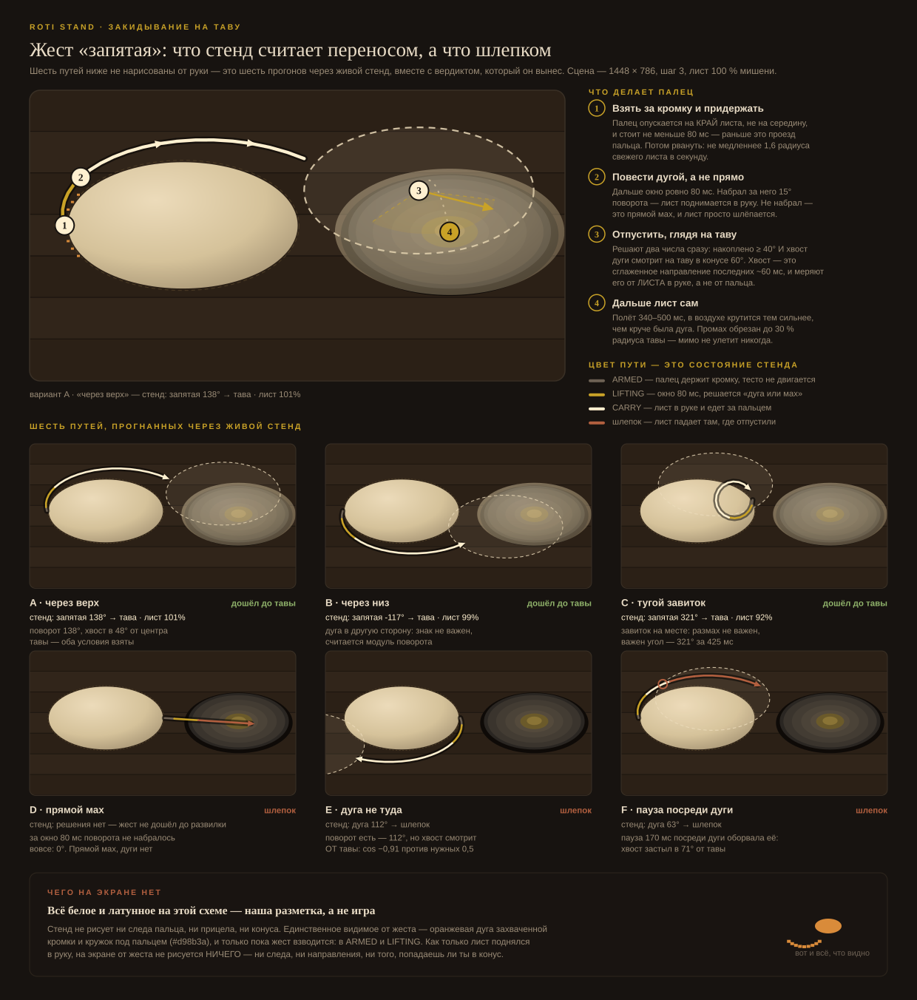

# Как устроено тесто в стенде

> Обновлено 16.09.2026, сборка «объём конверта · 12» (ветка `codex/roti-continuation`). Это описание того,
> что реально написано в `stand.js` и `index.html` — не намерений. Если код разойдётся с этим файлом, файл обновить.

`index.html` содержит интерфейс, `stand.js` — симуляцию, ввод, рендер и звук. Внешняя загрузка
зафиксированного HTML с CDN снята; файлы работают с обычного локального HTTP-сервера.
`dough-closeup.artifact.html` — самодостаточный снимок этих двух файлов, не отдельный исходник.

## Автоматическая начинка → складки → нарезка (16.09.2026)

После обычной посадки на таву `startDish()` снимает геометрию целых ячеек собственного
листа. Разорванные ячейки не попадают в материал. Выпуклые и вогнутые квады делятся по
внутренней диагонали; самопересекающиеся — на две части в точке пересечения контура.
Распознавание прижима, шлепка и переноса осталось прежним.

Семь условных кружочков начинки появляются один раз со слегка случайными центрами.
Каждая порция обрезается целым материалом листа, включая его дырки. В сильно порванном
листе число порций может быть меньше; если все семь попали мимо, маленькая порция остаётся
на самой большой целой ячейке. Дальнейшие действия не меняют случайную раскладку.

**Складка:** коснуться внешней кромки и потянуть внутрь. Кромка выбирается по выпуклой
оболочке текущего материала с допуском под палец. Линия сгиба — серединный перпендикуляр
между захватом и концом жеста. **С сборки 5 — только внутрь:** сдвиг меряется вдоль внутренней
нормали захваченной кромки (не меньше 0,12) и смотрит внутрь не дальше 60° от неё; до 10 CSS px
от точки касания жест не читается (дрожание пальца). Раньше сдвиг на 10 px вдоль боковой
кромки складывал полсписта: сгиб поперёк движения проходил через середину листа. Она делит полигоны; поднятая часть отражается и ложится
сверху с обратным порядком слоёв. Палец двигает предпросмотр; отпускание фиксирует,
отмена касания/потеря фокуса убирает только предпросмотр. Нулевой или почти целиком
переворачивающий лист жест не засчитывается. Дырка сохраняется в своём слое; другой
клапан может закрыть её. Это плоская геометрия слоёв, не 3D-самоконтакт и не объём начинки.

**Нарезка:** после хотя бы одной складки лист снимают на рабочую часть стола — жестом
(ниже, «Снятие на стол») или кнопкой «к нарезке»; это тот же объект. Масштаб подбирается по его фактическим границам. Прямой свайп
задаёт конечный отрезок лезвия. Из всех слоёв теста и начинки вычитается узкая полоса
шириной 0,018 начального целевого радиуса — геометрический зазор, а не линия поверх
изображения. Длина, направление и число резов свободные; короткий надрез не продолжается
до края. Кусочки пока не раздвигаются и не становятся отдельными физическими телами.
«Отменить» возвращает предыдущее действие (до 20 в текущем режиме); переход на стол
заканчивает историю складок. Проверки закрытого конверта и оценки результата пока нет.

**Видимый торец (сборка 2):** вдоль настоящих границ разреза рисуются полосы
пересечённых слоёв теста и начинки. Внутренние рёбра триангуляции торцов не получают.
Начинка появляется на срезе только в месте её фактического пересечения ножом; оттенок
теста сохраняет прожарку. Для читаемости на телефоне толщина условно увеличена и показана
внутри кромки своего кусочка: геометрия реза и положение кусочков не меняются. Это
условное изображение сечения, ещё не объёмная физика. В B · 224 детали читаются лучше.
Торец следует за undo и поворотом; дорогие пересечения кэшируются по неизменяемой геометрии,
во время предпросмотра складки не пересчитываются.

**Вид на столе — рельеф по пикселям (сборка 26, после проб 24–25).** На столе конверт рисуется не
гранями, а картой пикселей основания: у каждого пикселя — верхняя грань, её высота и стопка слоёв под
ней (до 8). Столбцы пикселей рисуются от ближнего края к дальнему, как рельеф в воксельных движках:
стенка идёт ровно по контуру куска, дальние куски закрыты ближними, надрез — настоящая щель. Разбор
рёбер «контур / не контур» (сборки 24–25) ломался на рваной границе сетки — отсюда «ножки», «окна» и
стенки поверх соседей. Картинка считается один раз на состояние материала (рез, отмена, размер
экрана, «низ сквозь лист») и дальше копируется: в своём Chrome 27 мс на холсте телефона и 88 мс на
2560×1245 (лучшее из 8, машина под нагрузкой). На таве конверт по-прежнему рисуется гранями.
Сборка 29 (проверка 26–28): высоты, цвета вершин, номера слоёв и «грани у резов» считаются раз на
снимок материала, рабочие массивы и картинка переиспользуются между кадрами, три последние
картинки хранятся (отмена и отказ от поворота не пересчитывают рельеф); после потери 2D-контекста
картинка кладётся заново. **Нож режет по нарисованному верху:** точка касания на столе поднимается на
среднюю высоту рельефа (раньше рез ложился на 20–38 CSS px выше пальца); линия реза рисуется там же.

Локальные координаты материала и история сохраняются при повороте/изменении размера
экрана. «Заново» очищает пробу. Кнопка **«проба конверта»** создаёт отдельную растянутую
заготовку на таве для быстрого входа; обычный перенос использует собственный лист.
Настройки сырого теста на этапе конверта скрыты. Артефакт пересобирается из index + stand.js.

**Жарка возвращена в сборке 2 по отзыву владелицы.** Приостановка в первой пробе
конверта не сохраняется как правило игры. Тепловая история `dish.thermal[source]`
принадлежит материалу, поэтому складка/рез её переносит, а undo не возвращает время назад.
Сушка и цвет развиваются на таве, на столе нагрев прекращается; шипение следует за сушкой.

**Две стороны (сборка 3, #21).** У каждого исходного квада две поверхности:
`dry:[d0,d1]`, `cook:[c0,c1]`. Сторона 0 — та, что легла на таву при посадке, сторона 1 —
исходный верх; обе начинаются с нуля. Грань лежит на стороне `turned ? 1 : 0` и показывает
вверх другую. В каждом образце контакта (снизу вверх):

- нижняя сторона слоя получает тепло, прошедшее сквозь всё, что ниже, — это её сушка;
- открытая сверху сторона сохнет с долей `UP_DRY = 0,35` от того же тепла (**inferred**,
  источника нет); сторона под другим слоем или под начинкой не сохнет вовсе;
- цвет растёт только у стороны, прижатой прямо к стали, и только после её сушки. Закрытые
  поверхности между слоями не румянятся — вывод из условия цвета (>120 °C, a_w<0,6), не цитата.

Следствия, которые стоит знать заранее. До переворота открытый верх остаётся бледным;
внутренность конверта не румянится никогда; клапаны получают цвет только после переворота —
то есть до `cover` порядок цвета конверта «база → клапаны», наоборот против
`docs/frying-mechanics.md` §1 п. 6 (сам тот порядок источниками не подтверждён).

**Время (сборка 14; владелица 16.09: «жарка слишком долгая»).** Игровое время сжато двумя
множителями — условность, не физика: сушка ×1,25 (`DRY_RATE` 0,1625), цвет ×6 (`COOK_RATE`
0,048). Один общий множитель разбор 16.09 отверг: равномерное ×4 сжимало мокрую фазу, и
переворот садил на сталь уже сухую сторону. Замер (две складки на 2-й и 4-й секунде,
переворот через 3 с после золота), проба / естественный лист: схватывание 2,1 / 2,5 с,
золото первой стороны 20 / 22 с, второй 12 / 15 с, роти 39 / 44 с, от золота до тёмного
(1,2) ~24 с. До сжатия первая сторона золотилась ~82 с. `panTime` остаётся в настоящих
секундах; лист на таве без блюда жарится с теми же скоростями. Владелице роти за ~40 с
показался слишком быстрым (17.09): с сборки 15 цвет по умолчанию ×3,5 — первая сторона ~30 с,
роти 55–59 с, от золота до тёмного ~41 с; прибор «жарка, роти» — 40 / 60 / 85 с (цвет ×6 / ×3,5 / ×2).

Строка прибора: «низ» — сушка и цвет прижатых к стали сторон (по ним же идёт шипение),
«верх» — цвет открытых взгляду сторон, «золото низа» — время до 0,4 в каждом сеансе на
таве (посадка и каждый переворот начинают новый). Поле пятнистости `contact` у обеих
сторон одно; квад, разрезанный линией сгиба, усредняет обе ориентации — узкая полоса.

**Переворот (сборки 4 и 6, #21).** Геометрия: каждая грань отражается относительно прямой
через центроид площади теста с нормалью, равной направлению маха; порядок слоёв
разворачивается, у граней меняется `turned`; материал и его стороны не трогаются — после
переворота на стали лежит другая сторона. Ось именно через центроид площади: через центр
рамки двойной переворот уводил бы косой лист (на L-образной фикстуре 0,125 при 30°).
Посадка сдвигается по направлению маха до 0,15 (растёт со скоростью, **inferred**), центроид
не уходит дальше 30 % радиуса тавы, но уже лежащий дальше не подтягивается. Начинка
(`dish.filling`, с сборки 59 — куски на листе) отражается вместе с пакетом. В стопке она
лежит над листом и под клапанами, после переворота — под листом: складка её не режет, а
сдвигает с клапана на основание, и клапан ложится сверху (в сборке 59 начинка рисовалась
поверх клапанов, исправлено в 60). Начинка лежит по одну сторону листа: открытый лист,
перевёрнутый с начинкой, держит её под собой, и банан с яйцом не кладутся, пока лист не перевернут
обратно (с сборки 62; до того новые куски ложились сверху, а следующая складка или переворот
сваливали их к старым, под лист). Переворот — запись в истории: «отменить»
возвращает геометрию, но не время; каждая посадка и каждый переворот (и его отмена)
начинают новый «сеанс» на таве.

Полёт 0,45 с живёт в `dishFlight` вне `dish`: лист сжимается вдоль маха по |cos πu|,
поднимается и на середине показывает другую сторону; тень остаётся на стали. В полёте
не идёт жар, шипение почти стихает, не работают «отменить», «к нарезке», новый жест и
ресайз (он откладывается до посадки); «заново» полёт сбрасывает. Посадка — в `step()` по
`performance.now()`: шлепок и волна шипения. Торец для новой геометрии считается при взлёте.

**Жест переворота (сборки 6–7, вариант A для пробы).** Коснуться края на таве и резко махнуть.
Мах — это скорость ≥ 850 CSS px/с (наименьшие квадраты по отсчётам за последние 80 мс,
чтобы исход не решала частота событий, урок #91), путь штриха ≥ 40 px, штрих ≤ 300 мс,
отпускание не позже 50 мс после последнего сдвига. Штрих — непрерывное движение: пауза
дольше 40 мс начинает новый (неподвижный палец событий не шлёт, и пауза перед махом не
должна входить в мах); начало штриха хранится в жесте, а не в буфере отсчётов; время берётся
из `e.timeStamp` события, если он в шкале `performance.now()`. Первые 110 мс быстрого штриха
предпросмотр складки не рисуется. У угла оболочки учитываются оба ближайших ребра. Иначе отпускание — складка (только внутрь)
или ничего. Удержание не используется: оно закреплено за прижимом (решение 07.09). Все пороги —
предложение для пробы; каждый жест на таве пишется в лог («лог») со скоростью, длительностью,
путём и исходом. Кнопка «перевернуть» — технический вход, как «к нарезке».
Ответ на касание края — голосом предмета, только после касания: лопатка под краем,
приподнятая кромка с тенью, тихий скрежет. Медленная складка остаётся с предпросмотром;
быстрый мах от края теперь переворот, а не складка — это изменение для прежней привычки.

**Снятие на стол (сборка 8, решение владелицы 16.09; со сборки 70 жест другой — см. «Перенос в руке»).** Коснуться края на таве и медленно
вывести лист наружу — за борт, на рабочую часть стола. Ведение наружу — сдвиг не меньше 0,12
вдоль внешней нормали кромки (конус 60°) или прочь от центра конверта (конус 80°: от угла палец
идёт к столу наискось). Пока палец ведёт, лист целиком едет за ним и не жарится (шипение стихает);
в первые 110 мс быстрого штриха лист не двигается — это может быть мах. Снятие засчитывается, если
лист сдвинут не меньше чем на 0,45, палец прошёл не меньше 60 CSS px и отпущен над рабочей зоной
стола за бортом тавы (1,08 радиуса): лист перелетает на стол за 0,35 с (поза плавно переходит от
тавы к позе нарезки, лёгкий подъём, мягкий шлепок), жар прекращается. Иначе лист возвращается.
Если лист уже поехал за пальцем, отпускание не бывает махом. Несложенный лист сдвигается лишь на
0,15 и не снимается (как и кнопкой). **Первая «отменить» на столе возвращает лист на таву** вместе
с историей складок — случайное снятие обратимо. Кнопка «к нарезке» использует тот же перелёт.
В перелёте не работают нарезка, отмена и ресайз; «заново» его сбрасывает; посадка после
возврата из фона — без шлепка.
Раньше (сборки 8–9) хватало сдвига пальца на 10 px у нижней кромки в портрете — и отменить
это было нельзя; найдено второй независимой проверкой.

**Подача (сборка 9, решение владелицы 16.09).** На столе появляется кнопка «подать». Она
замораживает блюдо (жест, отмена и кнопки отключены) и показывает карточку-черновик: складки,
перевороты, резы, порции начинки, рваные ячейки, цвет снизу и сверху словами и числом, время на
таве и золото низа по сеансам; отдельной строкой — «не сложено», «конверт не переворачивали»,
«не нарезано». Что помнит след роти, не решено (#50) — карточка так и подписана. «Следующий роти»
убирает карточку и даёт новый кусочек на шаге 1; 350 мс после этого касания поля не читаются,
чтобы второе касание кнопки не прижало новый кусочек. Каждая подача пишется в лог, номер подачи
переживает перезагрузку. После подачи кнопки тавы скрыты. Заметка «верх не прожарен» ставится по
фактическому цвету верха. Карточка — слой интерфейса (`inUI`), касание по ней в тесто не уходит.
**Полив сгущёнки (сборка 42).** На столе, после нарезки, кнопка «сгущёнка» включает
отдельный режим: рез не читается (обёртка `onDown` на iPhone и pointer на холсте).
Палец ведёт нить; точки — координаты стола (`dishInputLocal`). Ширина обратно
скорости руки. Отпускание: выбег 0,22 с с затуханием скорости (инерция вязкой нити).
Нить не гаснет — мокрый блеск садится к пятну. Сброс — «заново», «следующий роти»
и возврат листа на таву. Карточка: «узор налит» / «без полива». Сахар и зубочистки
в стенде ещё нет.
 Слова цвета: <0,05 сырое, <0,25 бледное,
<0,6 золотистое, <1 румяное, <1,3 тёмное, дальше «до угля».

**Поворот на плоскости (сборка 27, просьба владелицы 17.09).** Сложенный роти можно повернуть:
на таве — после первой складки, на столе — всегда. Телефон: два пальца на поле; второй палец
отменяет начатую первым складку, рез или прижим, дальше блюдо поворачивается вслед за пальцами.
Угол меряется в плоскости стола (стол на экране сжат по вертикали), поэтому точка под пальцем
остаётся под пальцем: поворот пальцев на 30° на экране — около 45° на столе. Мышь: колесо или
прокрутка тачпада над полем (0,25° на пиксель, фиксируется после 0,22 с тишины; щипок тачпада и
колесо без блюда отдаются странице) и перетаскивание с Option/Alt вокруг середины блюда. Пока
крутят, поворот только показывается; на отпускании запекается в геометрию, как переворот: грани,
центры ломтиков, куски начинки `dish.filling` (с сборки 61: до того следующая складка или переворот
возвращали начинку на неповёрнутое место) и резы поворачиваются вокруг середины (на таве — центроида теста, на столе —
середины раскладки), это один шаг истории, «отменить» его откатывает. Меньше 1° не считается.
Тепло принадлежит материалу и не меняется. На таве контакт пересчитывается один раз (сталь греет
по радиусу), пятна прижима и купола снимаются — лопатка поддела лист; поворот звучит скребком
лопатки. На столе масштаб следует за границами повёрнутого блюда во время поворота, поэтому на
отпускании ничего не прыгает; рельеф стола во время поворота считается вполовину разрешения.
Кнопки посреди поворота (перевернуть, к нарезке, подать) его отменяют; «отменить» посреди поворота
отменяет только сам поворот. Нажатие на поле сразу после поворота колесом сначала фиксирует поворот.
Option-перетаскивание — только левой кнопкой. Ресайз ждёт конца поворота. На столе середина
раскладки после поворота — середина повёрнутых границ (и в предпросмотре тоже), поэтому блюдо не
съезжает к таве. Шаг «вернуть на таву» не выпадает из истории, сколько бы действий ни было на столе.
Свет подушки на таве при повороте стоит на месте (наклон поворачивается вместе с блюдом).
**iPhone (сборка 28):** на телефоне владелицы два пальца не повернули блюдо (сборка 27; причина не
установлена — симулятора iOS нет). Поставлены три защиты. Собственные жесты Safari (`gesturestart/
gesturechange/gestureend`) не отдаются странице для масштаба; если поворот касаниями не начался,
блюдо ведёт угол жеста Safari (`e.rotation`). Если iOS отменяет касания посреди поворота,
сделанный поворот фиксируется. Список пальцев на поле сверяется с `e.touches`: палец, чей конец не
дошёл до страницы, считается отменённым — он не делает одиночный палец «вторым» и не оставляет
висящую складку или рез. Строка отладки показывает пальцы на поле и исход поворота («два пальца»,
«жест Safari», «нельзя: не сложено»…), в журнал пишется `twist-try` с причиной. В журнал жестов
пишется `kind: "twist"` с входом (`touch`, `wheel`, `alt`), режимом и углом (0 — отменённый).
Все числа — для пробы.

**Толщина и объём (сборки 11–13, решение владелицы 16.09).** Это 2.5D — слои и карта высоты,
без объёмной физики (#34 открыт). Все миллиметры **inferred**: источников на толщину уличного роти
нет; опора — «тонкий, почти прозрачный лист» и подброшенное тесто пиццы 0,12–0,18 мм.

- **База.** Толщина 1 — кусочек, отрезанный от колбаски. Заготовки шагов 2–3 теперь меряются от
  него же (раньше от расплющенного диска): шаг 2 ≈ 0,195 (руками 0,22), проба конверта ≈ 0,036
  (руками у мишени 0,031). Проба сохнет так же, как настоящий лист. Следствие для разрывов — в
  разделе о дырках: заготовка шага 2 теперь рвётся от первого сильного шлепка, как и ручной путь.
- **Миллиметры.** 1 ≈ 14 мм, лист у мишени ≈ 0,5 мм. Сушка ∝ 0,5 мм / толщина (×0,25…×2,5):
  толстые места сохнут дольше, тонкие быстрее; скорость цвета от толщины не зависит.
- **Начинка.** С сборки 18 порция — один ломтик банана: 3 мм, плато до 85 % радиуса (до того —
  семь порций по 4 мм с плато до 65 %). Центр порции переезжает со складкой и переворотом, рез его
  сохраняет.
- **Тепло сквозь стопку.** Слой теста пропускает exp(−мм/1,05) (0,5 мм → 0,62, как было), начинка —
  exp(−мм/5) и ещё свою тень; всё, что под начинкой, получает ×1/(1+мм/1) (4 мм → ×0,2,
  спецификация §1: ×0,15…0,25). Клапан над начинкой поэтому никогда не греется сильнее базы под ней.
- **Вид — один конверт (сборка 13).** Карта высот (сетка 48×48, слой в ячейке учитывается один
  раз) и высота стопки под центром каждой грани считаются по-прежнему точно: из них берутся жарка,
  тень и толщина в карточке. Рисуется же **одна поверхность**: где тесто лежит поверх чего-то,
  рельеф сглажен широко (радиус 0,3 короткой стороны, два прохода скользящего среднего) и от
  исходного остаётся 12 % — пологая волна над порциями и ступень клапана. Одиночный лист и открытая
  начинка не сглаживаются; лист рядом с открытой порцией лежит на своей высоте, а не тянется к ней
  шатром. Высота берётся в каждой вершине, поэтому у соседних граней в общей точке она одна —
  «пластин» над порциями после переворота больше нет. Свет — по склону сглаженной поверхности,
  ещё сглаженный на ячейку. У края конверта (грани у пустых ячеек, толще 1,2 мм) — боковая стенка
  от стали до верха; открытая начинка рисуется последней, со своими стенками. Полёт переворота
  несёт объём (на ребре маха толщина сходит к нулю), высоты обеих сторон считаются при взлёте.
  Предпросмотр складки берёт высоты из последнего снимка, переворачивает поднятую стопку и строит
  свою сетку верха; стенка торца доходит ровно до нарисованного верха, слои делят её в настоящей
  пропорции. В карточке подачи — толщина конверта в настоящих мм.
- **Почему подушка.** Владелица 16.09 после переворота увидела «распавшуюся» начинку и предположила,
  что жареный роти выглядит общим конвертом, а не тестом, облепившим каждый кусочек. Сверено с
  двумя видео уличных роти ([Паттайя, Beach Road](https://www.youtube.com/watch?v=gZ8KIImJSIw),
  [How to Make Banana Roti](https://www.youtube.com/watch?v=3aERMj2HYyA)): начинка разложена
  тонким слоем, конверт — ровный квадрат со скруглённым краем и слоистым боком, верх плоский,
  порции видны лишь слабыми пятнами и волной; линии клапанов видны на сложенной стороне.
  Там же видно, чего в стенде нет: пятнистое, «леопардовое» золото по верху и прозрачная лужица
  масла вокруг (#21).

**Прижим (сборка 16; владелица 07.09: «удержание пальца = прижим… дольше держишь — сильнее»).**
В середине листа (дальше 0,30 от кромки, палец на тесте) прижим с первого кадра, пятно идёт за
пальцем, мах отсюда не переворачивает; до схватывания быстрый сдвиг — резерв щипка (#19). У кромки
палец становится прижимом только после 450 мс неподвижности (допуск 0,06 за край) — «миг подержи —
махни» остаётся переворотом; сдвиг на 10 px отпускает прижим и ведёт к складке, снятию или маху.
Под пальцем жар ×(1 + сила·уровень) в радиусе 0,18 с мягким краем; прижимы в одном месте не
складываются — берётся самый сильный, новое касание подхватывает гаснущий рядом; уровень растёт за 0,5 с, спадает
с τ 1,5 с (inferred); прибор «прижим» 0,35 / 1. История не пишется; при полёте, на лопатке и на
столе прижим замирает вместе с жаркой; складка, переворот и снятие его снимают. Вмятина — мягкое
тёмное пятно; голос — свой (мокро — глухо, сухо — звонкий хруст), шипение не трогается. Для #60:
пройти весь лист удержаниями по 1 с — первая сторона быстрее на 5 %, пятнистость не выравнивается.

**Пузыри (сборки 17, 20; решение 25.08: пузыри прижимаются).** Пока сторона на стали сохнет (средняя
сухость 0,2–0,85), по одному поднимаются 3–5 куполов в случайных местах целого голого теста — не у
начинки, не у края и дырки; радиус 0,06–0,14, растут ~3 с, пока сохнет кольцо вокруг. Под куполом
стали нет — пятно остаётся бледным. Лопается от прижима (в середине сразу, у кромки — когда прижим
включился), от складки, от взлёта на переворот или на стол; сам опадает через 2–4 с после роста
(пар ушёл) или раньше, если кольцо досохло. Сборка 17 садила купола на самое тонкое и держала их
до сухого — поиск источников 17.09 этого не подтвердил (`docs/papers.md`). Звук: растёт — тихое «пш» вверх, лопается —
щелчок и выдох. Вид — пологий купол цвета теста с тенью и бликом. Числа inferred. Так у прижима
появляется понятная цель (владелица 17.09: «не поняла, какой прикол в прижимании»). Старые наборы
модели проверяются без куполов (`DOMES=false` в харнессе), новые — с ними.

**Маргарин (сборка 19; решение 25.08: в v0 бесконечный).** Кусок — у дальнего от стола борта.
Касание куска (если палец не на тесте) — мазок: жир ложится на открытую сталь с шипением, у кромки
листа (0,06) затекает под лист, глубже под листом не пишется. Карта жира 32×32 в долях PAN_R —
на таве: переживает складку, переворот, отмену, гаснет с τ 0,55 с (`FAT_TAU`; до 20.09 было 25 с), новый лист — чистая тава. Жир
под листом — до +10 % жара сверх базовой плёнки ×1,05 (жир везде — первая сторона на ~9 % быстрее)
и хруст «жир × сухость»: чаще треск, в карточке «край мягкий / хрустит / сильно хрустит». Жест
от куска — предложение ассистента.

**Готовность видна и слышна (сборка 16).** Нижний слой на таве показывает на передних торцах
широкую полосу своей корочки — кромка румянится вместе с низом. После сушки треск чаще и громче,
полоса шипения звонче по мере цвета низа (к золоту — вдвое чаще).

**Условности отрисовки** (не физика; держать отдельно от физических величин):

| что | как | почему |
|---|---|---|
| рельеф стола | верх теста — поверхность теста (`atBase`) ×1,4, потолок 5 мм (`SLAB_MM`), сглаженная в пределах теста мелко (~2 CSS px) и крупно (~30 CSS px); мелкого рельефа остаётся 25 % (`TABLE_RELIEF`); открытый ломтик лежит сверху своим профилем ×0,45×1,4 (до 1,9 мм) и в сглаживание не входит; цвет вершины — среднее граней одного слоя; свет по наклону в экране, вполсилы; у края куска — скруглённая губа; пиксель помнит до 8 слоёв, при переполнении выпадает нижний слой теста над низом, начинка — почти никогда (только если выше одна начинка — тогда верхний слот; начинка в самом низу сохраняет над собой первый слой теста) (с сборки 62: с 60-й начинка лежит прямо над листом, и от пяти складок она первой пропадала из стенки разреза и полоски у реза) | при ×5 однослойные места читались ямами, края клапанов — хребтами, верх — мозаикой клеток жарки (снимки 17.09) |
| стенка на столе | у сгиба — гладкий бок теста с поджаристым низом (22 % высоты, цвет нижнего слоя теста); у разреза — слои стопки по их толщинам (`cutWallBands`): мякиш, две корочки, начинка жёлтая с ломтиками, привязанными к материалу вдоль реза | в узком пропиле видна только верхняя часть дальней стенки, как в жизни |
| полоска начинки | у разреза по верху куска — полоса 0,014 (не уже пикселя по обеим осям) жёлто-яичная с неровными ломтиками там, где в стопке есть начинка; у самой кромки темнее | торец разреза смотрит на зрителя ребром или закрыт ближним куском, начинку иначе не видно (владелица 17.09); так читаются щели с бананом на видео |
| кромка клапана на столе | верх темнее (×0,87), если сосед сверху-слева лежит на большем числе слоёв теста; на самой кромке — светлая губа; только в виде C | после сглаживания высоты края клапанов иначе не видны; в A/B пиксель крупнее кромки |
| тень на столе | силуэт, сдвинутый на свою высоту (0,45 вправо и 0,12 вниз на единицу высоты), размытый | куски стоят на столе |
| торец на таве | в объёмном виде — вертикальная полоса под кромкой, обращённой к зрителю, ровно до нарисованного верха; только там, где тесто кончается (внешний край, рез); начинка — насыщенно-жёлтая полоса с овалами ломтиков, мякиш светлее; в плоском полёте — прежняя полоса внутрь кромки | владелица 17.09: «начинка в резах не видна»; кромки клапанов внутри подушки торцом не видны |
| корочки в торце | у слоя теста две полосы по краям — цвет его нижней и верхней стороны | показать, какая сторона прожарена; в виде A слой ~0,5 px и не читается |
| полёт переворота | сжатие по |cos πu| и подъём, без 3D | «взял → бросил → услышал → увидел», как у переноса |
| лопатка и приподнятый край | светлая лопатка, кромка выше на 2–4 px с тенью | ответ на касание (критерий подсказок 07.09) |
| высота на экране | ×2 (`Z_EXAG`, с сборки 31; со сборки 33 — кнопки «высота» ×1,5 / ×2 / ×3 / ×5 в панели, выбор помнится между заходами, адрес `?z=1…8` сильнее), 1 targetR ≈ 110 мм (`ROTI_R_MM`), свет сверху-слева видит 0,3 наклона | до сборки 24 ×3 без рельефа — «плоско»; ×5 (сборки 24–30) — куски-кубики: конверт в 6 мм рисовался на 13–25 мм (владелица 17.09, вечер) |
| рельеф не зависит от высоты | со сборки 32 свет, кромка, тень, купола и корки считаются по `Z_RELIEF` = 5 (`RELIEF_K` = 5/`Z_EXAG`): ступенька кромки меряется в «прежней» высоте, тень длиннее во столько же раз, порог бока тонкого — `0,2/RELIEF_K` пикселя; поджаристый низ на сгибе — не больше 40 % высоты стенки, корка в срезе — не толще 40 % полосы и не тоньше 0,9 пикселя; торец на таве не поднимается выше нарисованного верха больше чем на полпикселя | при ×2 всё это было подобрано под ×5: в виде A стенок не оставалось совсем (152 из 152 без стенки), свет ослаб в 2,5 раза, бока ломтиков пропадали в виде B, половина боков сгиба красилась целиком в поджаристый низ (независимая проверка сборки 31) |
| кромка реза | слои среза в стенке рисуются в пикселе от самого пропила (было — в трёх), а затемнение у кромки берётся как доля полоски, а не фиксированный пиксель | бок сгиба рядом с продольным резом читался бледными язычками, а в пиксельных видах затемнение съедало всю полоску начинки и она становилась оливковой (независимая проверка сборки 31) |
| цвет теста в раме | тонкое тесто просвечивает цветом того, что под ним. На тёмном столе стенда это [36,28,19]; в раме под листом светлая сталь, и лист уходил в серый и лиловый (владелица 17.09: «должно быть приятного желтоватого цвета»). Теперь: сырое тесто — [240,224,176]; просвечивание в раме тёплое — [176,146,104], пригашенное яркостью места с картинки (день светлее, вечер темнее); пол непрозрачности в раме 0,55 вместо 0,14, иначе растянутый лист растворялся в столешнице | цвет берётся с картинки только по яркости: тень под сырым роти песочная, а не стальная |
| рама экрана | кнопки «экран» в панели (у реки · у канала · без рамы; выбор помнится между заходами) или адрес `?frame=riverside` / `?frame=canal`, адрес сильнее: под стендом рисуется одобренный экран локации с **пустым** столом и тавой (`frame-riverside.jpg`, 71 КБ, получен правкой экрана), свой стол стенд не рисует. Зоны берутся с картинки (таблица `FRAMES`): у речного экрана рабочая поверхность 24…444 × 246…471 и тава — эллипс (800, 352) с полуосями 228×112; у вечернего (картинка переделана в сборке 41) — 120…615 × 340…520 и эллипс (824, 408) с полуосями 170×66 (логические 1024×576). У рамы может быть свой наклон `tilt` — камера художника: у вечерней 0,41 вместо 0,56, мерка — соотношение осей нарисованной тавы; в раме лист ещё и не крупнее тавы (запас 1,25, `sheetSpan`); прямоугольники переводятся в координаты стола обратной проекцией. В раме всегда полный вид (в A и B кадр рисуется в 80 и 224 пикселя, картинка превращалась в мозаику) и спрятаны приборы. Поверх картинки стенд рисует только игру — жир, кусочек маргарина и мишень растяжки; маргарин в раме лежит на дальнем **левом** борту на 0,78 радиуса, потому что правый край тавы обрезан кадром (сборка 40) | экран-склейка к октябрю (#102): играем в раме одобренного экрана, не выбирая ни разрешение (#15), ни стек (#30) |
| разлёт кусков | два пальца на нарезанном роти не только поворачивают его, но и разводят куски: щель растёт от расстояния между пальцами (`dishSpread`, до ×6, коэффициент 1,8), на отпускании куски съезжаются обратно за ~0,2 с. Материал не двигается: это множитель к обычной щели `PIECE_SPREAD` в отрисовке, в историю не пишется, отменять нечего. Движение «вглубь» делится на наклон стола (`TILT`), иначе поперечные резы раскрывались вдвое хуже продольных. Палец при разведении попадает в тот же материал, что и без него | владелица 17.09: «два пальца развести — и кусочки разлетятся, посмотрим внутри, а отпускаешь — обычный масштаб»; поперечные резы до этого не давали щели вовсе (проверка сборки 31); стенок разреза в картинке 34 630 → 39 507 при ×4 |
| толщина следует за материалом | высота на столе = поверхность теста (со всем, что под верхним слоем, включая начинку) ×1,4 с потолком 5 мм, дальше ×`Z_EXAG`. Замер 17.09 (сборка 33, `runs/continuation/review8/thickcases.cjs`, в мм материала): один сгиб 1,39 · четыре 2,55 · восемь 4,71 (потолок 5,00) · четыре без начинки 1,40 · четыре с тройной начинкой 4,15. Начинка почти удваивает толщину, сгибы множат её, крайний случай упирается в потолок — на экране при ×2 это 10 мм, толщина настоящего толстого роти | владелица 17.09: «это же будет зависеть от толщины конверта, в том числе сколько начинки» — да, до потолка; сторож TH30 |
| толстые места | одиночное пятно не выше соседей (радиус 3 клетки) + 1 мм; высота на экране насыщается: `visMM(h) = 5·(1 − e^(−h/5))` — 0,5 мм → 0,48, 5 мм → 3,2, 14 мм → 4,7; открытый ломтик — жёсткий диск на тесте под своим центром, бок не выше своей толщины; у дыр внутри конверта стенки нет, полоса начинки в торце — только на разрезе ножом | нерастянутые и скомканные при неаккуратном переносе куски (толщина до 14 мм) при ×5 стояли башнями, ломтики на них — столбами, края дыр — оранжевыми брусками (владелица 17.09, сборка 30); толщина в карточке и тепло — по настоящим мм |
| один конверт | рельеф теста поверх стопки сглажен (`ENV_BLUR` 0,3, остаётся `ENV_DETAIL` 12 %), одиночный лист и открытая начинка — как есть | так выглядит жареный роти на видео; карта высот и жарка не меняются |
| стенка края | грани у края конверта толще 1,2 мм (`WALL_MIN_MM`) получают боковую сторону до стали цветом ×0,66 | край читается толщиной; ступенчатый край одиночного листа без стенки не зубрится |
| раздвинутые куски | кусок — связное тесто (складка связывает слои, пропил разделяет); кусок отходит на 0,022 (`PIECE_SPREAD`) поперёк каждого реза, который его отделил; надрез ничего не двигает; штрих реза считается в координатах материала куска под пальцем | после «подушки» узкая щель ножа не читалась (владелица 17.09); 0,045 оказалось «очень широкой щелью»; материал, тепло и резы не сдвигаются |
| щель надреза | настоящий пропил 0,018 в рельефе стола: щель до стола или верх дальней стенки, по краям — полоска начинки (сборка 26; в 23–25 — тёмная линия поверх) | из трёх резов читался один: два были надрезами (17.09) |
| ломтики банана | порция — один ломтик (сборка 18): ~16 кружков толщиной 3 мм пятном в середине листа, с просветами; сверху — мякоть с мягким ободком и мелкими семечками, обрезка по открытым граням | жёлтые капли читались желтками, горки — «группками» (владелица 17.09); на видео ломтики лежат одним слоем; желток будет отдельной начинкой |
| корочка по кромке | у нижнего слоя на таве нижняя полоса торца — 55 % высоты слоя цветом стороны на стали | жарку снизу иначе не видно до переворота (17.09) |
| свет | видит половину преувеличенного наклона (`LIGHT_SLOPE`) | крупные куски на столе иначе «мнутся» бликами |
| «низ сквозь лист» | к цвету видимой стороны примешивается цвет нижней с весом `(1 − толщина) × k`, k = 0 / 0,3 / 0,6 (прибор, по умолчанию 0,3) | без звука жарку до переворота иначе не видно; на таве настоящий лист матовеет, опора на просвечивание есть только у сырого листа |

Контакт пересчитывается по фактическим полигонам снизу вверх после посадки, складки,
undo и смены раскладки: сетка 48×48 берёт образцы покрытия. Прямой контакт имеет нижний
материал в радиусе тавы; передача через следующий слой теста условно ×0,62, через начинку
×0,45. Нагрев фрагментов одного исходного квада усредняется по образцам площади. Крошечные
фрагменты, пропущенные сеткой, получают дополнительный образец внутри своей геометрии
с той же проверкой лежащих ниже слоёв: они не остаются холодными из-за размера.
Толщина и пятнистость контакта наследуются от исходного материала; прежняя плоская
сетка не используется для положения сложенных частей. Цвет непрерывный, без прежних
16 ступеней прожарки. Постоянный звук использует влажность контактирующего материала.

Это упрощённая жарка, не полная теплофизика: две стороны на исходный квад, общий
контакт у обеих; коэффициенты передачи через слои и `UP_DRY` не откалиброваны; `cover`
(тень начинки на нижнем слое) не реализован. Переворот, снятие и подача подключены (ниже);
украшение и настоящая карточка следа (#50) — нет. Переход к нарезке не объявляет блюдо приготовленным.
#20/#21/#53 остаются открытыми.

## Модель листа: сетка из узлов и «волокон»

Тесто — **равномерная решётка 38×38, обрезанная по кругу**: ~1060 узлов и ~4000 связей
(горизонтальные, вертикальные и обе диагонали каждой ячейки — диагонали держат сдвиг).
Узел — точка теста с позицией и скоростью. Связь — «волокно» с **длиной покоя**: сколько
ей положено быть в ненапряжённом состоянии.

Раньше сетка была полярной (24 кольца × 48 спиц) — она вырождалась в центре и рвалась
сама от любого движения; это опровергнуто замером в первый же день.

## Решатель: XPBD

Каждый кадр — 8 подшагов. В каждом: узлы двигаются по скоростям с затуханием → каждая
связь подтягивает свои два узла к длине покоя (насколько мягко — ползунок **податливость**) →
скорости пересчитываются из фактического сдвига. Это стандартный position-based подход
(XPBD), тот же класс, что в тканевых симуляциях.

## Пластичность: почему растяжение остаётся

Чисто упругая сетка пружинит обратно и «прозрачного листа» не даёт — это было опровергнуто
замером. Поэтому связи **запоминают** растяжение: если связь растянута сильнее порога,
её длина покоя ползёт к фактической длине (скорость — ползунок **текучесть**). Плюс
выравнивание: перетянутые волокна отдают недотянутым, иначе лист рвался у пальца, не дойдя
до цели. Общий потолок растяжимости — 125 % от мишени: дальше тесто не растёт ни одним путём.

## Толщина: сохранение объёма

У каждой ячейки запомнена площадь при рождении. **Толщина = была / стала.** Выросла площадь
вдвое — ячейка вдвое тоньше. Цвет считается из толщины: толстое — непрозрачное бежевое,
тонкое темнеет к цвету стола, то есть «просвечивает». Никакого отдельного счётчика толщины
нет — она следствие геометрии.

## Раскладка стола: две, по ориентации кадра

Стол делится на **рабочую зону** (тесто) и **зону тавы** — по ДЛИННОЙ стороне кадра
(⚑ решение владельца 08.09.2026):

- **альбом** — тесто слева, тава справа, деление по ширине 50/50;
- **портрет** — тесто внизу, тава вверху, деление по высоте, и лист закидывается снизу вверх.

Жест на раскладку не смотрит: конус прицела считается на центр тавы, поэтому «запятая»
поворачивается вслед за ней сама.

Вертикальные границы зон берутся по **видимой полосе стола**, а не по числу `cv.height`:
перспектива сжимает стол в `TILT = 0,56` раза, и координата `y = cv.height` приходится
примерно на 3/4 высоты кадра — считая по `cv.height`, нижнюю четверть не занимал никто.

**Размер тавы считается по свободному месту в кадре**, а не по доле зоны: от кромки теста
до края. В кадр обязан помещаться борт (1,08 радиуса), тень (1,16) может уходить за край.
Потолок — 1,45 полуширины роти, чтобы на вытянутом экране тава не раздулась вокруг крошечного
листа. Сравнивается именно полуширина роти НА ТАВЕ (`targetR` × перспектива), а не сам
`targetR`: лист рисуется поузловой проекцией, а тава — эллипсом от `PAN_R` без множителя.

Так тава стала шире роти в 1,26 раза в портрете и в 1,16 в альбоме. До 08.09 было 0,76 —
роти торчал за борт на любом экране; см. запись в `../../docs/decisions-log.md`.

**Смена размера кадра лист не пересобирает** (сборка 66). Поворот телефона и панель Safari
меняют холст, а координаты стола выводятся из холста, поэтому лист переносится в новую
раскладку целиком: узлы — от центра старой рабочей зоны к центру новой с множителем
s = новая мишень / старая, длины покоя — в s раз, площади покоя — в s², радиусы и мерка жеста —
в s. Толщина, карта расплющивания шага 1, сушка и цвет безразмерны и не трогаются; блюдо на
таве и на столе и раньше переносилось так же (теперь масштабируются и его длины покоя). Ресайз
посреди жеста по-прежнему ждёт отпускания. Мерка жеста после ресайза та же, что дал бы `build()`
для нового экрана, — распознавание жеста от ресайза не меняется.
До сборки 66 на шагах 1–3 ресайз звал `build()`: расплющенное пятно, растянутый лист и готовый
к таве шаг 3 заменялись свежей заготовкой (Chrome 390×844 → 844×390: лист 0,82 мишени стал 0,41).

## Жест: машина состояний

### Сборка 68 (17.11.2026): тяга и шлепок, квадратная мишень — на пробу, в ветке

Срез 1 из `runs/square-stretch-spec-2026-11-16.md` (#91). Всё ниже про шаг 2 в этом разделе
описывает сборку 66 и для ветки `feat/square-stretch` устарело там, где расходится с этим блоком.
Пороги — стартовые значения, не замеры; владелице на пробу сборка ещё не отдавалась.
Сборка 67 — первая версия среза; 68 — она же после ревью 17.11 (что изменено, помечено «68»).

```
RESTING → ARMED ─ медленно наружу → PULLING ─ отпустила / пальцы соскользнули → SETTLING (тяга)
             │                         └─ мах подтверждён ─┐
             └─ мах подтверждён ───────────────────────────┴→ LIFTING → FLYING → IMPACT → SETTLING
                                                              (сборка 70: развилки «дуга → CARRY» нет, мах от края — всегда шлепок)
```

- **Отсчёты.** Каждое событие — точка стола, точка экрана в gs (CSS px ÷ `gsCss()`) и время
  события. Штрих — движение без пауз длиннее 40 мс. Скорость — наименьшие квадраты за 80 мс
  штриха; разности соседних событий нет. Мёртвая зона — max(0,15 gs, 10 CSS px) от точки касания
  (68: она хранится отдельно, в памяти до 256 отсчётов). Число событий, чьё время пришлось брать
  по моменту обработки, пишется в журнал жеста (`t_fallbacks`, 68).
- **Шлепок**: скорость за 160 мс штриха ≥ `V_SLAP` (5 gs/с, адрес `?vslap=`), путь ≥ 0,45 gs,
  направление в пределах 80° от наружного радиуса. Пока палец идёт, решение принимается не раньше
  150 мс от начала штриха. Штрих короче судится по своему концу — на отпускании, при остановке
  пальца (50 мс без движения) или перед новым штрихом после паузы; шлепок при этом бьёт сам, не
  дожидаясь отпускания (68: раньше мах с торможением в конце, «рывок — стоп — отпустила» и мах
  сразу с касания читались тягой; пауза перед штрихом больше не нужна). Сила
  `min(3,5; 0,25·скорость·направленность)`, по пику скорости за время подъёма.
- **Подъём перед ударом** (68). Край, вытянутый за пальцем (не дальше 0,4 gs под быстрым махом),
  остаётся в руке весь подъём и полёт, в полёте отпускается наполовину и снимается ударом. В 67
  он отпускался в момент подъёма и успевал вернуться в ноль до удара. Полёт — 80–160 мс минус
  время, которое мах уже был на глазах сверх 80 мс: удар по длинному маху приходит через те же
  ~210 мс от начала движения, что на main.
- **Тяга**: медленно наружу, в пределах 65° от радиуса (68; было 80°). Край идёт за пальцем по
  полю смещений (ширина 1,0 рад; в 67 — 0,55) с отставанием `предел·tanh(путь/предел)`; предел —
  min(1,4 gs; 0,55 радиуса листа; запас до пунктира × 1,03; 1,25 радиуса соседей на ±30°).
  68: направление хода — не дальше 25° от радиуса хвата, ход — проекция пути пальца; каждый
  сектор кромки зажат пунктиром × 1,03 (доля хода одна на сектор и плавно между секторами).
  На отпускании длины покоя принимают новую геометрию; ход пальца короче 0,25 gs, отмена касания
  и потеря фокуса окна (68) возвращают лист бит в бит. Палец ушёл на 1,6 предела — тяга
  фиксируется сама. Между 4 и 5 gs/с ход края падает с 1 до 0,6; язык укорачивается до 0,4 gs
  только быстрее порога шлепка (68). Физика на время тяги стоит.
- **Внутрь и вбок** (дальше 65° от радиуса для тяги, 80° для шлепка) — ничего.
- **Мишень** — суперэллипс `0,90·targetR / (|cos|⁵+|sin|⁵)^(1/5)`, угол на 1,11 `targetR`.
  68: центр мишени — место на столе (центр листа на входе в шаг 2 и после переноса листа
  целиком), а не центр масс: пунктир не ездит за тестом. Рост шлепка (длины покоя и рывок
  скоростей) гаснет по углу от пунктира до пунктира × 1,12 у сторон и × 1,05 у углов (68;
  сборка 75: шлепок встаёт у пунктира заранее — см. «Шлепок встаёт у пунктира»).
  Готовность — `sheetFill()` ≥ 0,92: меньшее из 18-го перцентиля кромка/мишень по 48 секторам,
  самой короткой середины стороны и самого короткого сектора × 0,92/0,85 (68).
  Угол засчитывается (нота и вспышка), когда он дошёл до 0,97 мишени (до сборки 76 — 0,93), а
  кромка на ±30° от диагонали — до 0,80 (68); судится по стоящему листу или под пальцем во время
  тяги (76). Аккорд и мигание борта тавы — когда отмечены все четыре угла и лист готов (68),
  то есть на шаге 3 (76).
- **Снято**: `V_MIN`, `ACTION_MIN`, `IMPULSE_K`, `HOLD_MIN`, `trackSweep()` (поворот считает
  `pathTurn()` по пути с шагом 0,2 gs), тяга дуги хвата в LIFTING (`liftPull`, `LIFT_REACH`) —
  причина и цифры в комментарии в `stand.js`.

Проверки: `checks/square-stretch-regression.cjs` (T1–T9h) и `checks/model-regression.cjs`.
Замер Node 17.11, сборка 68: 17 из 18 и 15 из 17 (на main 16 из 17; оба падения — пресеты с
податливостью 30, #95). 1024 прямых штриха на 30/60/120/240 Гц с дрожью ±1,5 px и без — ошибок 0,
расхождений между частотами 0; 312 штрихов «живого пальца» (торможение, рывок — стоп, без паузы
перед махом) — ошибок 0; 100 медленных протяжек — 100 тяг. Шаг роста через порог 1,37 раза (норма
≤ 2); одними тягами лист готов за 10; 4 шлепка и тяги за углы дают угол/сторону 1,23 (у мишени
1,23) при кромке 0,94–1,05 мишени, вывернутых ячеек от тяг 0.

Не выполнено и остаётся долгом:
- **T9b** (закрыт сборкой 75 — см. «Шлепок встаёт у пунктира»): случайные серии тяг и шлепков, 12 из 12 вне нормы — кромка до 1,19–1,31 мишени
  (норма ≤ 1,14), площадь 1,10–1,23 круга (норма ≤ 1,10). Перебирают шлепки: сторона, дошедшая
  до пунктира, растёт дальше (девять шлепков — 1,23 мишени). Проверено, что это не рывок скоростей
  у дотянутой стороны, не `creep()` и не язык подъёма; причина не найдена. Короткий край вылечен
  (0,86–0,92 при норме ≥ 0,85).
- Прямой мах длиной 2 gs с дрожью ±1,5 px в 7 случаях из 216 читается дугой ≥ 15° и уходит в
  CARRY: шлепок случается, но лист переезжает под палец. Запятая снимается срезом 2.
- Живой iPhone, сценарии C1–C6 и T9b на 200 сериях не делались; скорости шлепка владелицы
  (журнал `dough_gestures`) никто не смотрел — риск «её шлепок медленнее 5 gs/с» открыт.

### Сборка 66 и раньше

По `docs/slap-input-audit.md`, с ветвлением на переносе (25.08.2026):

```
RESTING → ARMED → LIFTING ─ прямой мах ──────────→ FLYING → IMPACT → SETTLING
                     └─ дуга ≥15° за 80 мс → CARRY ─ хвост к таве, дуга ≥40° → TOSS → посадка
                                               └─ иначе: лист опускается, дальше FLYING (шлепок)
```

Один объект `action` — единственный источник истины; один активный палец, второй игнорируется.

- **Шаг 1 — расплющить.** Прижатый палец растит длины покоя вокруг себя (сильнее под пальцем,
  слабее по всему куску) — кусок расползается в лепёшку. Дошёл до 42 % мишени — авто-переход
  на шаг 2, тем же листом.
- **Шаг 2 — растянуть.** Касание только выбирает дугу края (тесто не двигается!), прижим
  расширяет хват (насыщение за 100–250 мс), резкий мах классифицируется по скорости и
  направлению (нормировка на размер экрана, а не листа — один и тот же мах руки работает
  одинаково всю игру). Первые 80 мс маха (LIFTING) дуга хвата тянется к пальцу, но не дальше
  1,15 радиуса листа от его центра: без предела быстрый мах вытягивал край языком и лист
  сминался (19.10.2026). Затем 80–160 мс «полёта» и **удар**: краткий импульс скоростей +
  одноразовое пластическое растяжение длин покоя с весами «мягкого лепестка»
  `(0,45 + 0,55·((1 + cos угла к маху)/2)^1,5) · (0,28 + 0,72·край²) · (0,32 + 0,68·толщина)`,
  сила 0,24: сторона маха растёт примерно вдвое сильнее спины, но растёт весь лист.
  Пока лист успокаивается после удара, **кромка оплывает** (сборка 65): каждый узел кромки
  сдвигается к середине между соседями по кругу (6 в секунду, `RIM_RELAX`), связи у сдвинутых
  узлов принимают новую длину. Без этого лесенка круга, вырезанного из квадратной сетки,
  с каждым шлепком раздувалась в пилу: выпуклые углы лесенки стоят дальше от центра, а рост
  длин покоя идёт с весом край² — средний зубец кромки на шаге 3 был 0,024–0,031 мишени
  (медиана 0,027; у пробы — кнопка «шаг 3» — 0,017), стало 0,008–0,015 (медиана 0,012).
  Сглаживаются только соседние узлы: лепесток и вытянутые стороны остаются. Распознавание
  жеста не меняется. Условность против сетки, не физическая величина (inferred).
  Скоростной импульс сам по себе площадь не растил (жёсткий решатель гасил его раньше
  пластичности — сработал стоп-сигнал аудита §6.6), поэтому рост закреплён явно.

## Перенос в руке (сборки 70–71, 17.11.2026) — на пробу, в ветке

Срез 2 из `runs/square-stretch-spec-2026-11-16.md`. Заменяет раздел про «запятую» ниже (он оставлен
как история сборки 66) и абзац «Снятие на стол» выше. Все числа — стартовые, не замеры; владелице
на пробу сборка ещё не отдавалась.

```
RESTING → ARMED (касание в середине листа) ─ палец ушёл на 12 CSS px ─┐
          ARMED / PULLING (край) ─ второй палец на листе ──────────────┴→ CARRY (лист идёт за рукой 1:1)
CARRY ─ отпустила над тавой ───────────────────────→ LAY 0,30 с → на таве (жарка)
      ─ быстро отпустила в сторону тавы, лист готов → TOSS (полёт, как раньше) → на таве
      ─ отпустила в другом месте / отмена касания ──→ BACK 0,16 с → лист на своём месте на столе
```

- **Вход.** «Середина» — ближе к центру мишени, чем 0,45 радиуса кромки в ту сторону (`CARRY_ZONE`);
  дальше касание, как раньше, берёт край. Второй палец на листе (не дальше 1,1 кромки), пока первый
  держит край, середину или тянет, — тоже перенос, ведёт середина между пальцами. Второй палец меряется по листу там, где
  он сейчас нарисован (в руке лист сдвинут). Подняла один палец из двух — лист остаётся в руке у
  второго (ведущая точка не прыгает), отпускает последний палец: случайное касание второй рукой
  лист больше не роняет (сборка 71). Таймера удержания нет. `?carry=mid|two|both` выбирает вход для пробы.
- **В руке.** Узлы физики стоят; сдвиг применяется к картинке (`xf`). Лист приподнят на 0,10 радиуса,
  под ним тень, звук отрыва. Пока палец на экране, лист в руке — ни таймера, ни остановки по
  неподвижной руке (раньше «запятая» жила 0,45 с). Борт тавы светится, пока отпускание положит
  лист на неё: центр листа не дальше 0,75 `PAN_R` от центра тавы (`LAY_ZONE`).
- **Укладка (LAY).** Лист встаёт на место за первые 60 % времени, ближний к игроку край касается
  стали на 15 % времени, остальное раскатывается от игрока: у каждого узла своё время касания по
  его месту вдоль листа, дальний край до этого приподнят на 0,30 радиуса. Шипение растёт с долей
  листа, уже коснувшейся стали; шлепка нет, только тихий звук первого касания.
- **Бросок (TOSS).** Скорость руки на отпускании ≥ 7 gs/с (`TOSS_MIN`) в конусе 50° к таве **на экране**
  (в координатах стола вид из-за прилавка сужал конус в альбоме) и лист готов (шаг 3). Конус меряется
  от листа, а он уже ушёл за пальцем вбок, поэтому со сборки 71 бросок засчитывается и когда луч от
  листа по ходу руки попадает в саму таву (не дальше 1,0 `PAN_R` от её центра, `TOSS_AIM`): в портрете
  мах на 30–40° вбок, который пересекает таву, раньше возвращал лист на стол. Бросок
  недотянутого листа не считается: быстрый мах из середины на шаге 2 иначе сам закидывал бы лист на
  таву — та самая жалоба «кидается». Отнести и положить недотянутый лист можно (решение 08.09).
  «Рука ещё шла» — последнее движение не раньше чем за max(3 шага событий, 90 мс) до отпускания.
- **Посадка.** Центр листа не дальше от центра тавы, чем `max(0,05·PAN_R; 1,08·PAN_R − наибольший
  радиус кромки)` — углы остаются на стали (раньше промах до 0,30·`PAN_R`). Поворот — 0 или четверть
  оборота: «запятая» теперь только украшение — путь руки, повернувший за последние 5 gs на 60° и
  больше, добавляет четверть оборота; садится лист всегда по осям стола.
- **Возврат (BACK)** длится 0,16 с; касание в это время не теряется — лист сразу на месте и берётся
  снова (сборка 71).
- **Мах от края** — всегда шлепок: развилки «дуга или прямой» (`liftGate`, `COMMA_*`) больше нет.
- **С тавы на стол — тем же жестом.** Сложенный роти берётся за середину (дальше от кромки, чем
  min(0,30; 0,45 полуширины оболочки)): палец стоит — прижим, как раньше; повёл на 12 CSS px в первые 250 мс
  касания — роти в руке, идёт за пальцем и не жарится. Палец, который уже прижимает дольше 250 мс,
  поднимает роти только уйдя на 28 CSS px (`CARRY_GRAB_MS`, `CARRY_SLOP_PRESS_CSS`): прижим со
  сползанием остаётся прижимом. У готового конверта (четыре складки) полоса кромки изнутри —
  0,30 полуширины (`ENVELOPE_EDGE`), снаружи, на стали, прежняя: мах-переворот от кромки работает. Отпустила над столом за бортом тавы — перелёт к нарезке (тот же,
  что у кнопки «к нарезке»), над тавой — возвращается на место. Несложенный лист так не берётся
  (середина остаётся прижимом); повела его на стол — подсказка «Сначала сверни края — потом на стол».
  Подсказки о несработавшем жесте держатся 2,4 с (`dishNote`): раньше их в том же кадре затирала
  строка стадии жарки. **Ведение от кромки наружу больше ничего не двигает**: штрих наружу
  остался за махом-переворотом и со снятием не спорит.
- **Пропущенные кадры на таве.** Пауза штриха и «остановка перед отпусканием» у жестов лопаткой
  теперь, как на столе, растут со средним шагом событий жеста (`dishPauseMs` = max(40; 2,5 шага),
  `dishStaleMs` = max(50; 3 шага)), а разрыв — пауза, только если палец за него прошёл меньше
  100 CSS px/с **или разрыв длиннее max(100 мс; 3 шага событий)** — и на таве, и на столе
  (`LONG_GAP_MS`, сборка 71): первое событие маха после паузы несёт целый кадр пути, и «сдвинула,
  подержала, махнула» по одной скорости паузой не считалось — мах не переворачивал. Скорость маха не считается по двум отсчётам ближе 25 мс друг к другу.
- **Журнал жестов:** `kind: "lay" | "toss"` (вход `entry: mid|two`, время в руке, скорость на
  отпускании, поворот пути, промах `aim`) и `kind: "carry", outcome: "back"`; на таве —
  `outcome: "remove" | "carry-back"` с `carry: true`.

**Проверки** (`checks/carry-regression.cjs`, Node, настоящие обработчики касаний; числа — вывод
скрипта 17.11, сборка 71; события 30/60/120 Гц, через 50 мс и 60 Гц с пропусками до 50 мс, дрожь ±1,5 px):

| Проверка | Что | Итог |
|---|---|---|
| T10a | перенос из середины и отпускание над тавой, оба экрана, целый и рваный лист | лёг 4/4, поворот 0°, кромка ≤ 1,044 `PAN_R` |
| T10b | отпускание над столом | 8/8 лист тот же бит в бит |
| T10c | быстрый мах готового листа, 9 и 14 gs/с | в конусе бросок 12/12, вне — на стол 12/12 |
| T10c2 | портрет: мах на 20/30/40° от линии к таве; 90° и 150° | бросок 60/60; на стол 30/30 |
| T10d | недотянутый лист | отнести и положить можно 2/2; бросок не считается 12/12 |
| T10e | 8 исходов × 5 частот × 2 экрана × 4 зерна | 320 переносов, неверных 0 |
| T10f | дуга руки — четверть оборота, прямой путь — 0 | посадка всегда по осям |
| T10g | укладка 0,30 с | касание 0 → 0,999 монотонно, шипение растёт |
| T11 | удержание 1 с ±3 px, 100 в середине и 100 на краю | переносов 0; 3,5 с в руке — всё ещё в руке 5/5 |
| T11b | лист идёт за пальцем | ошибка 0 CSS px |
| T11c | второй палец; `?carry=` | 8/8 по ожиданию; после подъёма одного пальца лист в руке |
| T11d | отмена касания, уход в фон; дуга от края | лист бит в бит; на таву 0/30 |
| T12a | случайный второй палец в переносе (по столу и по листу) | 4/4: лист в руке, первый палец донёс или вернул |
| T12b | касание через 50 мс после отпускания (идёт возврат) | 5/5 частот: взят снова и уложен |
| T10h | сложенный роти: на стол / остановка над тавой / удержание | снят 11/11, вернулся 10/10, прижим 10/10 |
| T10i | от кромки: мах наружу / ведение наружу / складка внутрь | 40/40 переворот, 40/40 ничего, 40/40 складка |
| T10j | сдвиг 18 px, пауза 120/250/400 мс, мах с первым шагом 4/35/60 px | переворот 45/45 |
| T10k | прижим со сползанием 20 px за 1 с; повела сразу; прижим 0,4 с и 40 px; подсказка несложенному | прижим 10/10; в руке 10/10 и 10/10; подсказка 2/2 |

18/18. `model-regression.cjs` — 15/17 (два пресета compliance-30, #95), `square-stretch-regression.cjs` —
18/19 (T9b, известная).

Свой Chrome (CDP, настоящие касания, 390×844, дрожь ±1,5 px), сборка 71: перенос на таву 12/12; бросок
на 0/20/30/±40° — 30/30 (60 Гц и события через 50 мс), на 60/90/180° — на стол 18/18, на шаге 2 — 6/6
на стол; случайный второй палец 6/6 не роняет лист; два пальца 5/5; повторное касание через 50 мс 4/4;
на таве «сдвиг — пауза — мах» 25/25 переворот; конверт берётся в 15–34 px ниже центра (роти ≈ 146×84 px)
4/4, мах от его кромки переворачивает 6/6; прижим со сползанием — прижим; на столе шлепок 12/12,
«сдвиг — пауза — мах» 12/12, медленная тяга 3/3.

**Чего нет и что не проверено.** Вогнутости сторон при посадке (`LAND_CONCAVE` из спеки, *inferred*)
нет, и это намеренно: лист садится жёстко, тем же узлом в узел, каким был на столе. Тава нарисована
плоской (один тон плиты, без колец «в глубину», сборка 71). Быстрый мах из середины готового листа в
сторону тавы — бросок по спеке; если «кидается» вернётся на готовом листе, ручки — `TOSS_MIN` и
наименьшее время в руке. В руке лист рисуется прежней картинкой полёта (поячеечно, темнее, чем на столе) — раньше её
видели 0,4 с, теперь секунды. Роти в руке над тавой без тени, борт стола при снятии не светится.
Середина конверта в четверть листа со сборки 71 — почти весь конверт без полосы 0,30 полуширины у
кромки; попадание живым пальцем не проверено. Привычка «веду лопаткой от края на стол» теперь только показывает подсказку.
Привычка «тяну из середины» на шаге 2 поднимает лист (без последствий) — для этого `?carry=two`.
На живом iPhone сборка не проверялась: только Node и свой Chrome с настоящими касаниями.

## Конверт и переворот на таве (сборка 72, 17.11.2026) — на пробу, в ветке

Срез 3 из `runs/square-stretch-spec-2026-11-16.md`. Все числа — стартовые, не замеры.

- **Рамка конверта.** Лист ложится на таву ровно по осям стола, и у него четыре стороны. В момент посадки
  стенд запоминает рамку: середину листа, две оси и расстояние от середины до каждой стороны
  (`dish.env`, `envelopeFrame`). Рамка привязана к тесту, а не к экрану: поворот, переворот и «отменить»
  переносят её вместе с листом.
- **Складка — штрих от стороны к середине, с любой скоростью.** Конус — 70° к нормали кромки, и угол теперь
  меряется на экране (вид из-за прилавка сжимает вертикаль, и раньше штрих под 45° у боковых кромок не
  засчитывался). Быстрый штрих внутрь больше не переворачивает лист: в сборке 66 быстрая складка 100–130 px
  за 100–200 мс превышала порог маха и переворачивала 8 из 19 (`runs/fix91-diagnosis-2026-11-16.md`).
- **Ровная складка.** Если штрих не дальше 35° от оси стороны (`FOLD_SNAP_COS`), начат у самой стороны
  (`FOLD_SNAP_FROM` = 0,6 полуразмера) и прошёл от 0,35 до 1,5 пути до средней линии (`FOLD_SNAP_MIN/MAX`;
  штриху быстрее 500 CSS px/с глубина не важна, `FOLD_FAST_CSS`), складка ставится ровно: сгиб параллелен
  стороне на половине пути до середины, кромка клапана ложится на среднюю линию. Две противоположные
  стороны — прямоугольник, четыре — квадрат в четверть листа со швами крестом. Иначе (наискось, слишком
  мелко или глубоко, повторно по завёрнутой стороне) — свободная складка, как раньше.
- **Предпросмотр** клапана виден сразу и совпадает с тем, что ляжет. Бледный пунктир показывает, куда лягут
  кромки (квадрат в половину листа); завёрнутая сторона свою линию теряет, у готового конверта разметки нет.
- **Переворот — мах наружу или вбок** от кромки (порог прежний: ≥ 850 CSS px/с, путь ≥ 40 px, не дольше
  300 мс, рука ещё шла). У готового конверта складывать нечего, и мах от кромки переворачивает в любую сторону.
- **Подписи.** «Сторона завёрнута: N из 4», «Прямоугольник…», «Конверт готов…» и «Перевёрнуто…» держатся
  2,4 с (`dishNote`): раньше строка жарки затирала их в том же кадре. Готовый конверт — звук готовности.
- **Журнал жестов:** у складки `snap` (ровная или нет), `side` (0…3: +u, −u, +v, −v) и `env` (сколько
  сторон завёрнуто).

**Проверки** (`checks/envelope-regression.cjs`, Node, настоящие обработчики касаний; события 30/60/120 Гц,
через 50 мс и 60 Гц с пропусками до 50 мс, дрожь ±1,5 px; числа — вывод скрипта 17.11, сборка 72):

| Проверка | Что | Итог |
|---|---|---|
| E1 | четыре стороны к середине: 24 порядка × 5 частот, штрихи до 30° от оси, глубина 0,4–1,2, с яйцом и бананами | 140 конвертов (560 штрихов): ровные 560/560, сторона a×a, четверть квадрата листа; начинка внутри 1400/1400; после двух противоположных — прямоугольник 0,5 × 1 (50/50); круглый лист — тоже квадрат |
| E2 | свободные складки остаются: 45–55° от оси, мелкая 0,2, глубокая 1,8, повтор по завёрнутой стороне | складки, не ровные; мелкая — 32 складки и 8 «ничего»; неверных 0 |
| E3 | предпросмотр = итог | 120 штрихов: совпало 120/120 |
| E4 | складка или переворот на всех частотах | 500 махов 1018–1303 px/с: открытый лист внутрь → ровная складка 60/60, наружу и вбок → переворот 60/60 и 60/60; два клапана — так же; готовый конверт — переворот в любую сторону 180/180; медленно внутрь по конверту — свободная складка 5/5 |
| E5 | рамка едет с поворотом, переворотом и «отменить» | после поворота на 30°/−50°, косого переворота и четырёх отмен четыре складки дают квадрат a×a, середина на месте; оба экрана |
| E6 | цепочка: жарка идёт, мах переворачивает конверт, за середину — на стол, 4 разреза | оба экрана: конверт 4/4, переворот, на столе, 9 кусочков, ошибок 0 |

`model-regression.cjs` — 15/17 (два пресета compliance-30, #95), `square-stretch-regression.cjs` — 18/19 (T9b, известная), `carry-regression.cjs` — 18/18.

Свой Chrome (CDP, настоящие касания, 390×844, дрожь ±1,5 px), сборка 72: лист перенесён на таву касанием,
начинка в середине; медленные штрихи 60 Гц — 4/4 ровные складки, после двух противоположных — прямоугольник,
после четырёх — конверт; быстрые штрихи 540–1030 px/с с пропусками кадров — 4/4 складки, переворотов 0;
наискось 20–25° с событиями через 50 мс — 4/4 ровные; мах наружу от конверта — переворот 1/1; открытый лист:
мах наружу (60 Гц и с пропусками) и вбок — переворот 3/3, быстрый штрих внутрь — складка 1/1; конверт
унесён за середину на стол — нарезка 1/1. Ошибок JS 0. Выборка живой проверки маленькая.

**Чего нет и что не проверено.** Мах-переворот засчитывается от 850 CSS px/с; синтетический «быстрый» мах
в Chrome мерился 860–1080 px/с (в Node — 1018–1303), то есть близко к порогу; настоящий мах владелицы не мерили (это первый
кандидат на подстройку). Кромка листа после растяжки ступенчатая, и прямоугольник это видно. Лопатка
под пальцем не нарисована. На живом iPhone не проверялось.

## Рамка вечера (шаг 1 v0) — сборка 74, 17.11.2026, на пробу, в ветке

Спека — `docs/v0-step1-evening-frame.md`. Стенд по умолчанию открывается игрой: вечер из трёх шариков
с началом (лампа) и концом (крышка). Понятность без слов не доказана — проверяется пробой владелицы.

**Где живёт.** Весь вечер — в `evening.js`, он грузится после `stand.js` и только водит его. В `stand.js`
от рамки два флага и вызовы под `typeof`: `sheetHidden` (стол без шарика: лист и мишень не рисуются),
`fryHold` (тава под крышкой: `cookDish`, `cookStep` и раскладка банана/яйца стоят), `eveningOn()`.
Без `evening.js` (проверки в Node) и в режиме стенда стенд работает как в сборке 73.

**Режимы.** Игра — по умолчанию: `#panel` спрятана, поле во весь экран (в портрете раньше было 120vw).
Режим стенда — `?dev=1` или «панель стенда» в радио: класс `html.dev`, панель видна, рамка не рисуется
и касания не забирает; обратно — кнопка «радио» на панели → «спрятать панель стенда». Вечер при этом
сохранён и продолжается с того же места (начатый шарик — с комка).

**Раскладка** (`eveGeo`, пиксели холста, портрет): над тавой — полоса неба (половина свободного места),
под ней стойка; лампа висит справа в небе, радио стоит слева на стойке; миска — внизу под тестом.
В рамке вечера шаг 1 не раздвигает рабочую зону до 0,70 (`zone`), иначе тава прыгала бы между шагами.
Альбом работает по прежней раскладке стола; рамка в нём тесная (строки сверху ложатся на стойку).

**Ход вечера.**

| Что | Как | Журнал |
|---|---|---|
| Лампа | до касания лампы стол молчит, слов нет; касание — свет и первый шарик на столе | `lamp`, `ball` |
| Миска | 3 → 2 → 1 → 0; отвечает только при свободном столе | `ball` |
| Шарик | прежний путь стенда: расплющить → растянуть → на таву → (банан касанием середины) → конверт → на стол → разрез | — |
| На стойку | после первого разреза роти берут за середину (`cutMiddle`, внутренняя половина габарита) и ведут вверх; отпущен выше нижнего края стойки — подан, иначе остаётся на столе | `serve` (как у прежней «подать»), `pan/serve-carry`, `evening/serve` |
| Небо | цвет по числу готовых роти: сумерки → вечер → поздний вечер → ночь | — |
| Крышка, конец | миска пуста и третий роти унесён — крышка лежит на столе; перенесла на таву — лампа гаснет, «вечер окончен · три роти», ком теста | `lid-end` |
| Следующий вечер | касание кома — снова сумерки, три шарика, лампа не горит | `restart` (`from:"lump"`) |
| Крышка, пауза | `visibilitychange` → hidden, пока на таве что-то жарится (`phase==="PAN"`): крышка на таве, жарка стоит, поле ждёт; сняла переносом в сторону — идёт дальше. Тесто на столе, свободный стол, крышка ждёт на столе в конце вечера — крышка не ложится | `lid-pause`, `lid-off` |
| Радио | листок: звук (выключен по умолчанию), «начать вечер заново» (два нажатия), «панель стенда», «скопировать журнал», номер сборки | `radio`, `restart` (`from:"radio"`) |

**Сохранение.** `localStorage.roti_evening`, версия 1: `lamp`, `ballsLeft`, `rotiDone`, `lid`, `over`,
`ball` (шарик в работе), `stage`, `events` (журнал вечера, до 80 строк — общий `gestures` ограничен 200
и вытесняется шлепками). Пишется на каждом переходе и при смене шага. Перезагрузка возвращает вечер;
начатый шарик начинается с комка (узлы листа не сохраняются). После перезагрузки на таве пусто, поэтому
крышки паузы на ней нет (ревью 17.11: раньше её приходилось снимать после каждой перезагрузки, а в конце
вечера она читалась как «закрыто»); крышка оконченного вечера остаётся.

**Условности.** Середина нарезанного роти после первого разреза — перенос, а не рез: второй рез начинают
у края или снаружи. Ненарезанный роти, который повели из середины на стойку, не режется и не подаётся:
строка «Сначала разрежь — проведи через роти». Подсказки «следующий шарик — в миске» и «накрой таву
крышкой» появляются только через 6 с простоя; любое касание экрана начинает отсчёт заново.

**Слова сверху.** В игре сверху одна строка (`#live`); мелкая подсказка стенда (`#hint`) спрятана — на
375×667 они вместе ложились на радио и стойку. Строки стенда про то, чего в игре нет (кнопки «заново» и
«сейчас порвётся», яйцо), `eveningLive(cur)` заменяет простыми словами (таблица `EVE_WORDS`): «коснись
середины — ляжет банан…», «банан лежит · заверни четыре стороны к середине», «на столе · проведи через
роти — разрежь», «нарезано · возьми за середину и унеси наверх, на стойку», «порвался — ничего, неси на
таву». Крышка на 8 % шире тавы — из-под неё не видно ни листа, ни маргарина. Рамы-картинки («у реки», «у канала») в игре выключаются: вечер идёт на своём столе.
Яйца в игре нет (кнопка на панели стенда), банан кладётся касанием середины, как раньше.

**С домашнего экрана.** `manifest.webmanifest` («Макашница», standalone, портрет), иконки 180/192/512
(`icons/make-icons.py`: плоский роти на таве), `apple-touch-icon`, `apple-mobile-web-app-capable`.
На iPhone не проверено — только в Chrome.

**Проверки.** `checks/evening-regression.cjs` (Node, V1–V8): грузит `stand.js`, `banana.js`, `egg.js`,
`evening.js` в один контекст; целый шарик — настоящими обработчиками касаний. Живьём — свой Chrome без
звука, 390×844 и 375×667, вечер из трёх роти касаниями через CDP.

## Тётя Сом (шаг 2 v0) — сборка 75, 17.11.2026, на пробу, в ветке

Спека — `docs/v0-step2-aunt-som.md`. Первый гость: приходит, пока жарится первый роти, стучит по таве
(«хочу хрустящее» — словами не сказано нигде) и отвечает на поданный роти честно, по хрусту стенда.
Проверяем одно: видна ли разница двух ответов без слов и без звука. **Настоящих картинок ещё нет** —
стоят заглушки-силуэты, поэтому сам вопрос шага пока не проверен, проверена только логика.

> Сборка 78: ответ Сом теперь по обеим сторонам роти и по общему приговору стенда (`fryVerdict`), сырое
> она не берёт, горелому кивает без варенья. Что ниже расходится с этим — история; действует раздел
> «Жарку видно, и её можно испортить».

**Где живёт.** `guest.js`, грузится после `evening.js`. Рамка вечера зовёт его под `typeof`:
`guestUpdate` (из `eveningUpdate`), `guestDraw` (после неба, до стойки — стойка закрывает низ картинки),
`guestDrawOver` (после теста: пока нарезанный роти несут наверх, она видна поверх него),
`guestServe` (из `eveningServed`, до сброса стенда), `guestLive`, `guestReset`, `guestState`,
`guestExport`, `guestTook`. В `stand.js` от гостя одна переменная `panKnock` (px холста): `drawTable`
и лист на таве рисуются со сдвигом на неё. Без `guest.js` и в режиме стенда (`?dev=1`) всё как в сборке 74.

**Картинки.** `guest/som-1.png … som-4.png` (1 ждёт, 2 стучит, 3 кивок, 4 хруст; прозрачный фон). Если все
четыре загрузились — рисуются они, иначе заглушки. Место и размер — только `GUEST_SLOT` и `guestSlot()`:
рамка по середине экрана, от 34 px сверху до верхнего края стойки (стойка закрывает 2 px низа; ниже
этой линии гостья не рисуется — обрезка), ширина = высота × 1,1, не шире экрана минус 88 px с каждой
стороны (слева полка, справа лампа). PNG вписывается целиком, прижат к низу, по середине. Размер рамки
по замеру в Chrome: 183×166 px на 390×844, 122×111 px на 375×667 (было 100×91: на низком экране стойка
теперь тоньше — `eveGeo`, 40 px вместо 60 при полосе над тавой уже 300 px; нижний край стойки на месте).
Первым спрашивается только `som-1.png`: пока картинок нет, это один отказ сервера, а не четыре.

**Ход.**

| Что | Как | Журнал (`kind:"guest"`) |
|---|---|---|
| Приход | роти на таве (`phase==="PAN"`, лист открыт или свёрнут) и `panTime ≥ 8 с` или низ дошёл до «бледного» (`meanCook() ≥ 0,08`); на первом шарике, а если там не успела (роти сняли раньше) — на втором; на третьем не приходит | `arrive` |
| Стук | через 1,5 с после прихода картинка 2 на 1,2 с; тава с листом вздрагивает на 2 px вниз два раза (0,10–0,22 с и 0,40–0,52 с от начала стука, без плавности). Записан (`knocked`) только когда отстоял целиком: если перезагрузка пришлась до него или на него, он придёт через 1,5 с следующей жарки | `knock` |
| «Теплее» | низ роти перешёл на следующую ступень (`cookWord`: бледное → приготовленное → зажаренное) — стук на 0,8 с, тава вздрагивает так же; на каждую ступень один раз за роти | `hint` |
| Подача | нарезанный роти отпущен выше нижнего края стойки (как в шаге 1); если палец выше верхнего края стойки и левее лампы (вся полоса, не только её картинка) — роти ей, иначе на стойку. Пока роти в руке, она рисуется поверх него | `serve` с `step`, `crisp`, `panSeconds`; у `evening/serve` поле `to:"som"` |
| Ответ | по той же лестнице, по которой она стучит: наибольшая за этот роти ступень жарки стороны на таве (`gBest`) дошла до «приготовленного» (`cook ≥ 0,28`) — «хруст» (картинка 4), иначе «кивок» (3). Хруст стенда от маргарина (`dishCrisp ≥ 5,0`, число карточки) — тоже «хруст». Держится 2,5 с, вид не двигается | `answer` с `step`, `crisp`, `answer`, `gift` |
| Подарок | кивок — связка бананов, хруст — банка варенья; ложится на полку (слева над радио) сразу с ответом; полка появляется вместе с первой вещью | — |
| Села | после первого ответа та же рамка ниже на 8 % своей высоты (9 px на 375×667, 13 px на 390×844); на время второго ответа — снова в полный рост | — |
| Второй шарик | стучит только на переходах ступеней; второй роти — снова ей, ответ так же честный | `hint`, `serve`, `answer` |
| Уход | после второго ответа (когда он отстоял 2,5 с); если ей дали меньше двух роти — когда взят третий шарик | `leave` с `why: answered | third-ball` |

В строках `arrive`, `knock`, `hint` записано, что в эту секунду на таве: `crisp`, `bottom` (слово прожарки
низа), `panSeconds`; везде `ballNo`. По журналу видно, изменила ли она жарку после первого ответа.

**Пауза.** Пока тава под крышкой (`EVE.lid`), `guestUpdate` стоит: ни прихода, ни стука, ни подсказки;
сняла крышку — счёт идёт с того же места. Крышка посреди стука: тава встаёт на место, картинка 1,
остаток стука идёт после крышки. Ответ считается по времени кадров, поэтому свёрнутая страница
его не съедает. Ответ и подарок записываются в момент подачи: перезагрузка посреди ответа их не теряет
(после перезагрузки посреди второго ответа она уже ушла).

**Сохранение.** `roti_evening.guest`: `here`, `gone`, `knocked`, `answers` (`ballNo`, `crisp`, `step`, `answer`), `gifts`,
`taken`, `events` (журнал гостя, до 60 строк). Отданные ей роти считаются в `rotiDone` (небо темнеет,
вечер кончается на трёх), но на стойке не лежат. Новый вечер (ком теста или «начать вечер заново»)
начинается без неё и с пустой полкой — память между вечерами это шаг 5.

**Слова.** Сом не говорит. Пока она у стойки, служебная строка набрана мельче и прижата к верху
(`html.guest` в `stand.css`: 12 px, от 4 px): две строки кончаются на 31 px, над её рамкой (34 px) —
замер в Chrome по всем строкам вечера, 375×667 и 390×844. Свои строки при ней: «нарезано · за середину
и наверх — гостье или на стойку», «неси наверх — гостье или на стойку», «под крышкой · сними её в
сторону — жарка пойдёт дальше», строки про банан короче.

**Почему ответ по жарке, а не по `dishCrisp` (ревью сборки 75).** `dishCrisp` растёт только от маргарина
под сухим листом (`жир × сухость`), жарка сама его не даёт: 20 с без маргарина — 0,00 → 0,00
(`guest-regression` G7), а до 5 маргарин надо водить вокруг конверта не переставая — 59 с в Node,
106–135 с настоящими касаниями. Стук и «теплее» зовут жарить дольше — и по спеке игрок, который жарил
дольше, получал тот же «кивок». Теперь ответ идёт по лестнице стуков: первая подсказка («бледное») —
«ещё рано», вторая («приготовленное») — «готово, это хруст». До неё настоящими касаниями — 63–86 с
на таве (три замера в Chrome; зависит от того, когда свёрнут конверт). Это долго; число (порог
ступени или `COOK_RATE` вечера) подбирается на пробе владелицы.

**Что не тронуто.** Таймеры гостьи идут в игровом времени кадров (как пауза и жарка): на медленном
телефоне ответ висит дольше 2,5 с, но не теряется. Банан и яйцо — грани блюда, рисуются в `drawDish`
и вздрагивают вместе с листом; `drawPanGlow` горит только пока лист несут к таве — со стуком не
совпадает. Альбомная раскладка: рамка выйдет около 40×27 px, не делалась.

**Проверки.** `checks/guest-regression.cjs` (Node, G1–G8): `stand.js`, `banana.js`, `egg.js`, `evening.js`,
`guest.js` в одном контексте, действия игрока — настоящими обработчиками касаний. G4 жарит до ступени
(быстрый пресет жарки стенда) и отдельно задаёт хруст скриптом (4,94 / 4,95); G6 — крышка посреди
стука и перезагрузка до и посреди главного стука; G7 — замер хруста от маргарина. Живьём — свой Chrome
без звука, 390×844 и 375×667, вечер касаниями через CDP: недожаренный роти (кивок, бананы), дожаренный
до второй подсказки (хруст, варенье), третий на стойку.

## Гладкая кромка листа (сборка 74, 17.11.2026) — на пробу, в ветке

**Откуда была лесенка.** Лист — решётка 38×38, обрезанная по кругу (1 060 узлов), и его граница — стороны
ячеек: ступени в одну ячейку. Это свойство связности, а не формы: как лист ни тяни, ступени остаются.
Сглаживало их одно — оплывание кромки в физике (`relaxRim`), а оно идёт только пока лист оседает после
жеста. Поэтому лист «образца» (кнопка «на таву», «проба конверта»), который не оседал ни разу, рисовался
лесенкой целиком, а грани блюда (`startDish`) уносили её на таву, в складки и в рельеф на столе. У листа,
растянутого руками, кромка к концу растяжки оплывала сама — там оставалась мелкая рябь.

**Что сделано.** Сглаживается только рисунок, в одном месте. `buildRimLoop` (в `build`) собирает кромку
по порядку обхода: стороны ячеек, принадлежащие одной ячейке (140 узлов). `rimDraw()` отдаёт координаты
для рисования `dX, dY`: узлы кромки стоят на линии, сглаженной вдоль обхода (треугольное окно ±`RIM_K` = 4
узла), все остальные — как в физике. Их читают все три пути: лист на столе (`draw`), лист в руке, в броске
и при укладке (`viewX`) и `startDish` — то есть грани блюда, а с ними тава, складки, переворот и рельеф
нарезки. `px/py`, толщина, дыры, начинка, складки и рез не меняются. У порванной ячейки кромки и
оторванного узла окно обрывается: разрыв остаётся разрывом.

**Числа** — `checks/edge-regression.cjs` (6/6, после правки по ревью — см. ниже), контур того, что рисуется: «до» (`RIM_K = 0`, кромка как в
физике, то есть сборка 73) → «после». Длина контура к длине его гладкой подгонки; сумма поворотов в
оборотах (гладкий выпуклый контур — ровно 1); вершины с поворотом больше 30°.

| Лист, 390×844 | длина / гладкая | оборотов | острых вершин |
|---|---|---|---|
| образец, стол | 1,267 → 1,004 | 21,4 → 1,36 | 76 → 0 |
| образец, тава | 1,266 → 1,004 | 21,3 → 1,35 | 76 → 0 |
| образец, прямоугольник (2 складки) | 1,257 → 1,035 | 23,1 → 3,26 | 80 → 4 |
| образец, конверт (4 складки) | 1,218 → 1,050 | 24,2 → 5,9 | 83 → 11 |
| только расплющен (0,41 мишени) | 1,209 → 1,003 | 19,0 → 1,0 | 76 → 0 |
| один круг тяг (0,84 мишени) | 1,011 → 1,002 | 4,2 → 1,0 | 4 → 0 |
| 24 тяги, стол | 1,006 → 1,004 | 2,03 → 1,08 | 0 → 0 |
| 24 тяги, в руке | 1,010 → 1,008 | 1,73 → 1,06 | 2 → 2 |
| 24 тяги, тава | 1,006 → 1,004 | 1,99 → 1,08 | 0 → 0 |
| 24 тяги, прямоугольник | 1,037 → 1,035 | 3,94 → 3,00 | 4 → 4 |
| 24 тяги, конверт | 1,053 → 1,051 | 5,77 → 4,79 | 8 → 8 |

Острые вершины, оставшиеся у прямоугольника и конверта, — настоящие изломы: там кромка пересекает сгиб.
Две острые вершины листа в руке — кончики углов растянутого листа: в повёрнутом и поднятом виде их поворот
чуть больше 30° (до 41°; в физике 38°), на столе и на таве — 20–25°.
Рисуемая кромка отстоит от физической: у листа после 24 тяг в среднем на 0,10 ячейки, самое большее на 0,31;
у только что расплющенного — на 0,28 и 0,62; после 16 тяг и 4 шлепков — на 0,13 и 0,69 (предел в проверке — 0,75).
Внутренние узлы рисуются на месте; `draw()` узлы физики не двигает (0). На альбомном экране 844×390 числа
близкие (стол: 1,007 → 1,004, оборотов 1,96 → 1,08).

**Правка по ревью (17.11): два предела сглаживания.** Ревью нашло, что в сжатом углу листа окно ±4 узла
длиннее самого угла: узел кромки уезжал внутрь дальше своих соседей, и ячейка рисовалась схлопнутой или
вывернутой (после 16 тяг — 3 вывернутых и 3 схлопнутых ниже 15 % площади, после ещё 4 шлепков — 6 и 3; сдвиг
узла до 0,93 ячейки). В `rimDraw()` добавлено:
- `RIM_CAP` = 0,8 — узел кромки рисуется не дальше 0,8 своей кратчайшей соседней стороны кромки;
- `RIM_AREA` = 0,3 — если ячейка рисуется меньше 0,3 своей физической площади, сглаживание её узлов кромки
  убавляется шагами по ×0,75 (на восьмом — до нуля), а у соседей по обходу — ступенями по `RIM_RAMP` = 0,2,
  чтобы переход к физической кромке не был изломом.
Проверка `G6` (расплющен → 16 тяг → 4 шлепка): вывернутых и схлопнутых ячеек 0 во всех трёх состояниях,
наименьшая нарисованная площадь ячейки 0,35 физической (без пределов — −2,39). Двойное покрытие граней блюда
на том же листе — 0,0189 при площади 3,77 (в сборке 73 — 0,0188, до правки — 0,0233; замер
пробой ревью). Предел ревью «0,35 стороны» отклонён: у расплющенного листа сглаживание ступени требует
сдвига 0,62 ячейки, и при 0,35 возвращается лесенка (36 острых вершин из 76), а 2 вывернутые ячейки остаются.
Порог площади ниже 0,5 по той же причине: сглаженная ступень срезает угловую ячейку наполовину.
Контур круглого листа в начале растяжки (`pathSheetOutline`) берёт те же `dX, dY`.

**Время кадра** (свой Chrome, 390×844 ×2, `performance.now()` вокруг `draw()`, 1 500 вызовов на замер, по два
замера, сборка 73 из основной копии против 74): лист-образец на столе — медиана 1,22 / 1,20 мс → 1,20 / 1,21,
p95 6,49 / 6,42 → 6,43 / 6,44; он же на таве — медиана 4,16 / 3,99 → 3,99 / 4,17, p95 10,45 / 10,82 → 10,62 / 11,23.
Разница внутри разброса между замерами. Сам `rimDraw()` — 6,8 мкс на вызов (с пределами, на листе после шлепков,
где они срабатывают, — 65 мкс в Node при load average 30). Это числа настольного Mac. Замер ревью с замедлением
процессора Chrome ×4: рисунок листа на таве — медиана 16,05 / 15,75 мс при `RIM_K = 0` и 16,84 / 17,04 при
`RIM_K = 4`, то есть рисунок тавы уже занимает около целого кадра 60 Гц в обоих вариантах; на iPhone SE 2 не мерили. Машина при замере была
загружена чужими прогонами (load average 24–87), поэтому числа по кадрам rAF шумные и здесь не приводятся.

**Живая проверка** (свой Chrome без звука, настоящие касания, `runs/edge-live/`): лист расплющен, 4 шлепка,
круги тяг до 100 %, перенос на таву, две складки, четыре складки; затем лист-образец с бананом и яйцом —
перенос, прямоугольник, конверт, переворот махом, унос на стол. Ошибок JS 0. Контур гладкий на столе, в
руке, на таве и в рельефе нарезки; в одном прогоне шлепки порвали лист — дыры остались рваными, как и были.

**Чего нет и что не проверено.**
- Зубцы ВНУТРИ сложенного листа остались: тень и свет клапана считаются по целым граням, поэтому вдоль
  края клапана на нижнем слое виден пилообразный переход тона. Это не контур, а шаг рельефа
  (`stackHeights` по граням); чинить — резать грани нижнего слоя по краю клапана.
- Кромка не толще остального листа: «край остаётся чуть толще и мягким» из `docs/roti-shape-fold-sources.md`
  в рисунке не сделан (в физике толще внешние 10 % радиуса — T9e).
- Окно ±4 узла слегка скругляет острый угол листа: кончик угла рисуется на 0,15–0,19 ячейки короче
  физического (до правки по ревью — на 0,38–0,43), метки захвата под пальцем — до 0,25 ячейки от узлов. Физическая
  форма и проценты мишени считаются по `px/py`, как раньше.
- Время кадра на iPhone SE 2 не измерено (см. «Время кадра»).
- Контур в проверке — след граней на плоскости (тава, конверт) без подъёма рельефа и боковых стенок.
- У самой кромки на таве местами видна тонкая штриховая полоска боковой стенки (стенки рисуются по граням); её не трогали.
- На живом iPhone не проверялось; время кадра на iPhone SE 2 не мерили.

## Шлепок встаёт у пунктира (сборки 75–76, 17.11.2026) — на пробу, в ветке

**Что было.** Шлепок растил длины покоя во все стороны по весу `slapWeight`, а у пунктира рост
гас только ЗА ним (до × 1,12 у сторон). Сторона на 0,95 мишени получала полный шлепок и за один
удар уходила на 1,25; лист от одних шлепков выходил круглым и широким. Это и был долг T9b
сборки 68 («причина не найдена»).

**Что сделано** (`slapRoom`, `plasticStretch`, `applySlapImpulse`; классификация жеста не тронута).
- До удара шлепок считает по 48 секторам, куда уедет кромка (средний вес шлепка вдоль луча ×
  сила × `SLAP_REACH` 1,3), и берёт от сектора не больше, чем осталось до пунктира. Пока запаса
  хватает всем секторам, шлепок прежний, бит в бит.
- Одной доли на связь мало: соседние секторы, растущие во все стороны, раздвигают и поднимают
  упёршуюся сторону (замер: 1,02 → 1,07 за шлепок при своей доле 0). Поэтому, когда хоть один
  сектор упёрся, остаток роста даётся полем смещений, как у тяги: каждый узел едет наружу по
  своему лучу, связи принимают длину сдвинутой сетки. Упёршаяся сторона стоит, остальные доходят.
- Углы: на диагоналях шлепок ведёт кромку до пунктира × `SLAP_CAP_CORNER` 0,92. Одни шлепки дают
  скруглённый квадрат (угол/сторона 1,12–1,13 при 1,233 у мишени), острый угол дотягивает тяга.
- Готовность (шаг 2 → 3) судится по листу в покое: только в `RESTING` и когда узлы встали
  (`READY_STILL`). Раньше шаг менялся на лету шлепка, и лист оседал ниже порога.
- Попутно найдена и закрыта ошибка `slapWeight`: у узла точно напротив маха вес выходил NaN, и
  лист исчезал целиком (серия 7155 из 200, первый же шлепок; на сборке 74 то же).

**Числа** (Node, 17.11; «было» — сборка 74 тем же скриптом).

| Проверка | было | стало |
|---|---|---|
| T9b, 12 случайных серий: самая длинная кромка, доля мишени | 1,19–1,31 | 1,037–1,068 |
| T9b, 12 серий: площадь, доля π·targetR² (у мишени 0,98) | 1,098–1,232 | 0,913–0,972 |
| T9i, 14 средних шлепков: кромка в конце, доля мишени | 1,043–1,23 | 0,925–1,03 |
| T9i: угол/сторона после 14 шлепков | 1,071 | 1,134 |
| T9i: сторона, вытянутая тягой до 0,954, после 6 шлепков по другим сторонам | 1,218 | 1,013 |
| T9c, 9 средних шлепков: сторона / угол, доля targetR (пунктир 0,90 / 1,11) | 1,107 / 1,18 | 0,907 / 1,036 |
| T8a: готов одними шлепками | за 7 (заполнение 0,912) | за 7 (заполнение 0,93) |

Наборы: `square-stretch-regression.cjs` 20 из 20 (было 18 из 19; добавлена T9i), `model-regression.cjs`
15 из 17 (те же два пресета с податливостью 30, #95), `carry-regression.cjs` 18 из 18,
`envelope-regression.cjs` 6 из 6, `edge-regression.cjs` 6 из 6.

T9b на 200 сериях (`--full`, 23 минуты) прогнан впервые: готов 200 из 200 за 7–27 жестов, самая
длинная кромка 1,019–1,083 мишени (норма ≤ 1,14), площадь 0,89–0,991. Вне нормы 3 серии из 200:
7130 и 7184 — самый короткий сектор 0,840 и 0,845 при норме 0,85; 7176 — одна вывернутая целая
ячейка от тяги рядом с дырой.

Живая проверка (свой Chrome, 390×844, настоящие касания, звук выключен): 14 шлепков силой 1,8–2,0 —
готов после восьмого, стороны 0,99–1,02 мишени, самый длинный сектор 1,03, углы 0,92–0,94; после
четырёх тяг за углы углы 0,98–1,01, стороны 1,03. Восьмой шлепок в этой пробе пришёл на потолке
силы (3,5) и пробил дыру — правило разрыва прежнее. Кадры — `runs/slapcap-live/c-montage.png`.

**Две нормы T9b изменены в проверке, обе названы в её выводе.**
- Площадь: в спецификации 0,95–1,10 от π·targetR². Нижняя граница — 0,97 площади самой мишени
  и несовместима с правилом готовности стенда (заполнение 0,92 даёт площадь от ~0,81). Раньше
  к ней подходили только потому, что шлепки уносили стороны на 1,2–1,3. Теперь нижняя граница
  0,85; ниже 0,95 — 7 серий из 12 и 124 из 200.
- Вывернутые ячейки от тяг считаются только среди целых. В порванной ячейке осколок стоит
  на месте, лист вокруг едет, и её площадь меняет знак — это дыра, а не складка от тяги.

### Правки по ревью сборки 75 — сборка 76 (17.11.2026)

Физика роста листа не тронута: меняется, когда стенд играет ноты, пишет «готов» и рвёт лист.

- **Ноты углов — только от тяг.** Порог угла `CORNER_TICK` 0,93 → 0,97: шлепки доводят углы до
  0,92–0,96, и на сборке 75 в 8 сериях из 12 одни шлепки отмечали все четыре угла и играли аккорд
  (замер ревью). Угол судится по стоящему листу (та же мерка `READY_STILL`, что у готовности) или
  под пальцем во время тяги: на лету шлепка разлёт узлов на миг давал углу 0,97. Аккорд «готово» —
  только на шаге 3. T9i: после 14 шлепков силой 2,3 и после 14 на потолке (3,5) отмечено 0 углов,
  аккорда нет. T8c, T9, T9g — все четыре угла от тяг, как раньше.
- **«✓ готов» в строке — когда шаг 3 защёлкнулся**, а не по одному заполнению: строка опережала
  шаг на 11–31 кадр (замер ревью), и бросок в этом окне оставался шлепком.
- **Шлепок, который лист уже не растит, его и не рвёт.** Дыра пробивается, только если средняя
  доля шлепка по секторам ≥ `SLAP_TEAR_SHARE` 0,10 (остальное правило прежнее: сила ≥ порога и
  тонкий лист). На сборке 75 восемь шлепков на потолке по готовому квадрату давали 148 рваных
  ячеек при той же площади и толщине (замер ревью). Теперь (Node, `runs/fix-b/tear.cjs`): пятый
  шлепок на потолке рвёт — доля 0,25, лист ещё растёт; шестой–двенадцатый — доля ≤ 0,06, новых
  дыр нет. По готовому квадрату (4 шлепка + 12 тяг, затем 8 шлепков силой 3,5) — 0 дыр.
  Порог по доле в самой точке дыры не подошёл: к толщине 0,10 сторона по маху уже стоит у
  пунктира, и шлепок не рвал бы никогда (падала проверка «сильный шлепок рвёт» в model-regression).
- **T9i: добавлен проход на потолке силы** (14 шлепков 3,5) со своей нормой 1,07: кромка 1,031
  мишени. Норма площади T9b: 0,85 → 0,88 (замер на 200 сериях 0,89–0,991).

**Отвергнуто, с замерами** (оба опыта — `runs/fix-b/pass1`, `pass2`):
- Пол рывка скоростей `SLAP_KICK_FLOOR` 0,25 → 0,10: самая длинная кромка от одних шлепков
  1,035–1,053 против 1,037–1,061 (Node, 6 серий, силы 1,3–3,5), а в T9b на 200 сериях вне нормы
  стало 5 серий вместо 3 (ещё два листа с коротким сектором 0,841 и 0,849). Пол 0 — 1,033–1,050.
  Заход за пунктир держится не на рывке. Возвращено 0,25.
- Непрерывный замер кромки (`rimProfile`: к узлам добавлены точки, где отрезок кромки пересекает
  границу сектора; радиус приводится к мишени на своём угле): T9b на 200 сериях — короткие секторы
  0,848 и 0,849 остались, появилась серия с 8 вывернутыми от тяг ячейками, площадь упала до 0,855,
  T8b — 12 тяг вместо 10. Без приведения к своему углу T8b падала (13 тяг). Откачено: «готов, потом
  не готов» лечится не одной непрерывностью замера. Побочное наблюдение: при мерке «по своему углу»
  кромка от шлепков — 1,007–1,015 мишени, то есть часть «захода за пунктир» — погрешность замера
  (узел сравнивается с мишенью середины сектора).

Наборы на сборке 76: `square-stretch-regression.cjs` 20 из 20, `model-regression.cjs` 15 из 17
(те же два пресета, #95), `carry-regression.cjs` 18 из 18, `envelope-regression.cjs` 6 из 6,
`edge-regression.cjs` 6 из 6. T9b `--full`: готов 200 из 200 за 7–27 жестов, кромка 1,019–1,083,
площадь 0,89–0,991, вне нормы те же 3 серии (7130, 7184 — сектор 0,840 и 0,845; 7176 — вывернутая
ячейка у дыры).

Живая проверка (свой Chrome без звука, 390×844, настоящие касания, 2 прогона): после 14 случайных
и 5 частых шлепков отмечено 0 углов, аккорда нет; тяги за углы отмечают угол на 0,97–0,99; шесть
шлепков на потолке по готовому квадрату — новых дыр 0 (в одном прогоне 15 рваных ячеек от шестого
шлепка, пока лист рос; в другом 0), самая длинная кромка 1,054 и 1,064. Кадры — `runs/fix-b/shots/c76-*`.

**Открытые долги.**
- «Готов, потом не готов»: после защёлки шага 3 лист иногда оседает до сектора 0,840–0,845
  (2 серии из 200; ревью — 1 прогон из 30). Шаг при этом остаётся третьим, строка «✓ готов» с 76
  держится за шаг, но процент показывает 90–91. Непрерывный замер кромки не вылечил (см. выше).
- Кромка от шлепков заходит за пунктир на 3–7 %, а не до 3 %, как писали на сборке 75: Node,
  случайные углы и силы — 1,031–1,061 (ревью), живые пробы — до 1,069 (ревью) и 1,064 (76).
  Тяге разрешено 3 %. Часть этого — погрешность замера (см. выше).
- Одной тяги за угол иногда не хватает до ноты: в живых пробах 76 два угла из двадцати после тяги
  на 50 px встали на 0,96–0,97 и не отметились — нужна вторая короткая тяга. Шлепки в покое дают
  углу до 0,96, так что порог ниже 0,97 снова пустит ноты от шлепков.
- Тяга рядом с дырой может вывернуть соседнюю целую ячейку (1 серия из 200).
- После шлепка «готов» (шаг 3 и, с 76, строка) появляется примерно через полсекунды после удара,
  когда лист встал (раньше — на лету). На телефоне не смотрели.
- Живой iPhone не проверялся; скорости шлепка владелицы по-прежнему никто не смотрел.

## Перенос на таву: «запятая» (шаг 3) — сборка 66, история



Схема выше нарисована не от руки: пути на ней — прогоны синтетическими PointerEvents через
живой стенд вместе с вердиктом, который он вынес (три доходят до тавы, два нет). Цвет пути —
состояние автомата. Шестая клетка — не вариант жеста, а находка: путь A, прогнанный восемь раз
подряд без единого изменения, доходит до тавы пять раз из восьми (см. issue про гейт 15°).
Всё белое и латунное на схеме — разметка: сам стенд не рисует ни следа пальца, ни прицела,
ни конуса, а только оранжевую дугу хвата и кружок под пальцем, и только пока жест взводится.

Идея владельца 25.08.2026: лист перекидывается на таву **круговым махом-«запятой»** —
подхватить, повести дугой, хвост дуги отправляет в полёт; в воздухе лист немного вращается,
падает на таву и начинает жариться.

Как реализовано:

- Пока мах идёт, копится **знаковый угол поворота** направления скорости (`sweep`) и
  сглаженный «хвост» направления (последние ~60 мс). Прямой мах: `sweep ≈ 0`.
- Если за 80 мс LIFTING палец повернул ≥ **15°** — это дуга: лист поднимается в руку
  (**CARRY**), физика замирает, лист следует за пальцем (сдвиг + тень под ним). Вести можно
  ≤ 0,45 с; рука остановилась на 90 мс — дуга кончилась.
- На отпускании: если дуга ≥ **40°** и хвост смотрит на таву в конусе **60°** — **TOSS**:
  полёт 0,34–0,5 с по плавной кривой, поворот листа = 0,55 × дуга (потолок ±80°), подъём
  и посадка. Промах от центра тавы сохраняется, но обрезается 30 % её радиуса — мимо тавы
  лист не улетает. Иначе — лист опускается на стол, и это обычный шлепок с дугой.
- **Размером лист не ограничен** (⚑ решение владельца 08.09.2026): недотянутый несётся на таву
  так же, как готовый. Запрета нет и предупреждения нет — толстый лист
  медленнее сохнет и иначе набирает цвет. Строка решения называет размер в момент броска.
- Посадка «запекает» сдвиг и поворот в узлы, `phase = PAN`, глухой шлепок + волна шипения.
  Посадка из шага 2 переключает интерфейс и сохранённый шаг на 3, сохраняя тот же лист.
  Пороги (15° / 40° / конус 60°) на живом iPhone не калиброваны, как и пороги свайпа (#1).
- **Направление броска задаёт раскладка, а не код жеста**: в альбоме дуга уходит вправо,
  в портрете — снизу вверх. Обе стороны дуги (через верх и через низ) работают одинаково:
  знак `sweep` не проверяется нигде, важен только модуль и куда смотрит хвост.

В полёте узлы физики не двигаются: сдвиг, поворот и подъём — свойство картинки,
применяемое к узлам один раз при посадке (как FLYING — таймер, а не траектория).

## Жарку видно, и её можно испортить (сборка 78, 17.11.2026) — на пробу, в ветке

Ветка `feat/frying-feel`. Источник — сводка трёх плейтестов сборки 77
(`runs/playtest-2026-11-17/SUMMARY.md`, пункты 1–7): руки заняты 10–20 с, потом около минуты игрок
смотрит на жарку, которой не видно и которую нельзя испортить. Решения ниже приняты Claude по правилам
владелицы от 17.11: звука нет — всё читается глазами; украшений нет — только то, что что-то сообщает;
слова простые, одна короткая строка; люди словами не говорят.

**Что изменилось для руки и глаза**

| было (сборка 77) | стало (сборка 78) |
| --- | --- |
| до «приготовленного» на стороне на стали — около минуты, дальше «темнеть не будет» | около 20 с на сторону; около 60 с на одной стороне — горелое |
| верх конверта не меняется, пока не перевернёшь | по краю верха ползёт румяная кайма цвета стороны на стали; чёрная кайма — низ горит |
| лист на таве сразу кремовый | сырой лист полупрозрачный, за 2–3 с становится матовым |
| строка называет невидимую сторону и спорит с Сом | одна лестница и один приговор на строку и на Сом; строка говорит только о видимом и только когда есть что делать |
| Сом смотрит одну сторону: лучше не переворачивать | Сом смотрит обе стороны; сырое не берёт; горелому кивает без варенья |
| мах-переворот от 850 px/с, промах не виден, мах внутрь — пятая складка | у готового конверта от 575 px/с; «почти» видно; пятой складки нет |
| маргарин не оставляет следа и почти не даёт хруста | лужица расходится и сходит, под краем шипит пузырьками, кусок убывает; 2–3 мазка вдоль края — хруст |

**1. Время (пункт 1).** По умолчанию включена быстрая жарка: `FRY_SECONDS` 180 → 40 (`COOK_RATE` 0,0075 →
0,028; кнопки прибора «жарка» остались и названы «быстро / средне / медленно»). Цвет у блюда начинается
раньше полной просушки: доля скорости цвета растёт от 0 при сушке `COOK_DRY_FROM` 0,15 до 1 при
`COOK_DRY_FULL` 0,40 (раньше цвет шёл только после сушки 1, и первые 15 с на глаз не происходило ничего).
Сушка (`DRY_RATE`) не тронута: от неё зависят купола. Потолок цвета `COOK_CAP` 0,92 → 1,4.
Отвергнуто: один общий множитель на сушку и цвет (сжимает мокрую фазу, купола не успевают — тот же
вывод, что 16.09) и порог «горелого» на прежнем потолке 0,92 (сгорало бы на 45-й секунде).

**2. Одна лестница и один приговор (пункты 3, 4, 6).** `FRY_STEPS = [0,08; 0,28; 0,55; 1,10]`,
`fryStep(c)` → 0 сырое · 1 бледное · 2 приготовленное · 3 зажаренное · 4 горелое. Отсюда берут ступень
`cookWord` (карточка, журнал), стук Сом (`guestStepOf`) и строка. Приговор тоже один — `fryVerdict(низ,
верх, хруст)` в `stand.js`, его зовут и строка (`fryHint`), и Сом (`guestVerdict`):

- `raw` — обе стороны ниже «бледного»;
- `burnt` — хоть одна сторона «горелое»;
- `crunch` — обе стороны не ниже «приготовленного», **или** одна «приготовленное», другая не ниже
  «бледного» и хруст от маргарина не меньше `FRY_CRISP` = 5 (маргарин под краем заменяет дожарку второй
  стороны);
- `nod` — остальное.

Отвергнуто правило «обе не ниже бледного и одна приготовленная» без маргарина: лист, пролежавший
открытым около 9 с, уже «бледный» по всей нижней стороне, она после складок становится верхом конверта —
и переворот был бы не нужен почти никому (замер F1 ниже).

**3. Строка (пункт 3).** Пока конверт не сложен, о жарке в строке ничего нет (`fryHint` → `null`): там
слова о банане и сторонах. «сырое · шипит, можно начинку», «→ сырое», «дальше темнеть не будет» убраны.
У готового конверта строк пять, каждая короче 36 знаков (столько влезает в одну строку на 375 px при
гостье):

- «мах от края — перевернуть» — пока переворот ни разу не удался за вечер (`flipLearned`);
- «край румяный — мах от края» / «край румяный — переверни» — сторона на стали «приготовленное», верх ещё нет;
- «поджарилось — за середину и на стол» — ровно тогда, когда приговор `crunch`;
- «край чёрный — горит» — сторона на стали «горелое»;
- пусто — в остальное время.

После четвёртой складки подпись — «конверт готов» (было три фразы в две строки).

**4. Жарку видно (пункт 2).** Всё это условности отрисовки, модель тепла они не трогают:

- **кайма** (`dishCookColor`, `dishLook`, `rimDist`): у сложенного роти край верха красится цветом стороны
  на стали и ползёт к середине, пока низ темнеет, — от `RIM_FROM` 0,16 до `RIM_TO` 0,72 полуширины роти к
  «зажаренному»; по шву конверта — узкая полоска того же цвета (`SEAM_W`). Кайма неровная: те же пятна
  контакта, что у самой корочки. Видна, только пока низ темнее верха; после переворота сверху сама
  румяная сторона. Кайма уезжает с роти на стол;
- **лист матовеет** (`doughSet`): непрозрачность теста от `SET_RAW` 0,58 до 1 по сушке стороны на стали до
  `SET_DRY` 0,17 — сквозь сырой лист видно сталь и лужицу;
- **горелое**: палитра `cookColor` продолжена за 1,0 до `CHAR`;
- **пятна от пузырей**: лопнувший купол оставляет на стороне на стали `DOME_SCORCH` 0,07 цвета — это
  единственная правка самой модели в этом пункте; видно после переворота и в срезе;
- **заплатки над начинкой**: на видимой стороне тон тянется к среднему тону этой стороны на
  `PATCH_SMOOTH` 0,55; в срезе слои честные.

**5. Переворот (пункт 5).** У готового конверта порог маха `FLICK_ENV_CSS` = 575 px/с (у открытого листа
прежние 850: там мах спорит со складкой). Мах от `FLICK_NEAR_CSS` = 300 px/с, не дотянувший до порога, —
«почти»: лист приподнимается на пятую часть пути и падает обратно за 0,34 с (`startAlmostFlip`,
в журнале `flip-almost`), материал не меняется. Готовый конверт больше не складывается: любой штрих от
его края — мах, «почти» или ничего. Свободных складок не больше четырёх (`foldCapped`); ровная складка
стороны конверта — всегда. Совет «на стол — возьми за середину» остался только медленному ведению от
края на стол.

**6. Маргарин (пункт 7).** Мазок от куска оставляет лужицу: она расходится (`FAT_SPREAD`, шаг диффузии по
карте 32×32) и сходит (`FAT_TAU` 0,55 → 2,6 с). Это по-прежнему глянец, а не жёлтая краска — решение
владелицы от 20.09 («жёлтая полоса не должна оставаться») в силе; изменилось то, что след теперь виден и
живёт несколько секунд. Мазок работает и на пустой таве (в вечере — при зажжённой лампе и снятой крышке,
в том числе пока стол свободен). Растекаясь, жир заходит под край роти: там он шипит мелкими пузырьками
(`drawFatFizz`) и растит хруст (`CRISP_GAIN` = 55). Кусок убывает (`butterLeft`, не меньше `BUTTER_MIN`
0,3 — ресурсом он не стал) и рисуется поверх листа; новый вечер — новый кусок. Штрих, начатый на куске, —
всегда маргарин: раньше касание над краем листа отдавалось листу, и мазок становился складкой.

**7. Тётя Сом (пункты 4, 6).** Ответ — по приговору `fryVerdict` обеих сторон поданного роти.
`crunch` — хруст и варенье. `nod` и `burnt` — кивок и бананы (горелому варенья нет даже с хрустом).
`raw` — она качает головой (картинка 1, голова два раза в стороны за 1,1 с — `guestHeadTurn`; у PNG
картинка чуть сжимается и уходит в сторону), роти остаётся на столе, подарка нет, вечер его не считает
(`guestRefuses`, стенд спрашивает её до `serveDish`; в журнале `refuse` и `serve-refused`). Строка:
«сырое — не берёт». На стойку сырой роти по-прежнему ложится молча. После переворота она отстукивает
ступени второй стороны заново: вторая «приготовленное» — знак «готово».

**Замеры**

Живые, свой Chrome, настоящие касания, 60 кадр/с, звук выключен (`--mute-audio`), оба размера
(журналы `runs/fry-work/live-*.log`, снимки `runs/fry-work/shots/`). Время — секунды на таве
(`dish.panTime`) от посадки листа, конверт сложен на 7–11-й секунде:

| | 390×844 | 375×667 |
| --- | --- | --- |
| сторона на стали «бледное» | 10,6–12,0 | 10,4 |
| «приготовленное» | 19,1–23,0 | 17,5–23,9 |
| «зажаренное» | 33,0–37,1 | 28,2–38,0 |
| «горелое» | 58,0–65,7 | 49,6–66,7 |
| после переворота вторая сторона «бледное» | +1,4…+2,3 | +1,6 |
| после переворота вторая сторона «приготовленное» (строка «поджарилось») | +10,2…+12,1 | +10,2 |
| три мазка вдоль края, хруст | 5,27 | 5,97 |
| «поджарилось» после переворота с маргарином | +4,7 | +3,4 |
| лужица на пустой стали сошла | 4,2 с | 4,2 с |

Разброс между роти — от толщины листа: чем толще растянут, тем дольше сохнет.

Модель в Node (`checks/frying-regression.cjs`, лист из скрипта, складки и мах — касаниями):
сложен на 6,8 с; сторона на стали «бледное» 7,8 с, «приготовленное» 16,9 с, «зажаренное» 29,1 с, «горелое»
54 с; без переворота верх быстро сложенного конверта остаётся сырым; мах на 16,9 с → вторая сторона «бледное»
через 2,8 с (с маргарином это хруст на 19,7 с), «приготовленное» через 12,1 с (хруст на 29,0 с). Открытый
лист «бледный» по всей нижней стороне через 8,6 с. Мах: 540 px/с — нет, 610 — да; 450 — «почти»; штрих
внутрь на 726 px/с (случай из плейтеста) — переворот, складок 4. Маргарин: лужица 100 → 148 клеток за
0,75 с, сошла за 4,3 с; три мазка вдоль края +2,03 +2,56 +3,83 = 8,42; мазок с переворотом — хруст через
2,4 с после маха. Кайма 0,11 → 0,21 → 0,34 ширины роти; яркость края по ступеням 195 → 193 → 176 → 123 → 45;
лист матовый через 2,9 с.

**Проверки.** Новый набор `checks/frying-regression.cjs` (F1 времена, F2 строка и лестница, F3 мах,
F4 маргарин, F5 вид числами). Изменены сознательно:

- `guest-regression.cjs` G4 — переписан под приговор по двум сторонам: таблица `guestVerdict`, жарка без
  переворота (кивок), с настоящим махом 700 px/с (хруст), вторая сторона «бледное» с хрустом 4,94 / 4,95,
  отказ от сырого, горелое. Прежняя подпроверка «считается наибольшая ступень за роти» снята: ответ
  теперь по сторонам поданного роти (цвет не убывает);
- G5, G6, G8 — у роти из скрипта цвет сторон задаётся явно (`cookAll`, `cookSides`): сырой роти она больше
  не берёт, а один хруст без приготовленной стороны — не хруст;
- `envelope-regression.cjs` E4 — медленный штрих внутрь на готовом конверте раньше обязан был дать пятую
  (свободную) складку, теперь обязан не дать ничего.

**Чего нет**

- Картинок Сом (PNG) в ветке нет: поворот головы проверен на заглушке; у PNG он сделан сжатием картинки
  и не смотрен.
- Сырой роти по-прежнему принимает стойка и засчитывает вечер; нерастянутый диск, дыры и «✓ растянуто»
  поверх дыр (остаток пункта 6) не тронуты.
- На столе после нарезки кайма видна, но сырой и горелый роти на стойке — тот же овал (пункт 14).
- Пузырьки и лужица проверены глазами по снимкам; на настоящем телефоне не смотрено.
- Скорость маха в живых прогонах — синтетические касания: порог 575 проверен в Node (540 — нет, 610 — да),
  вживую махи шли на 635–868 px/с, «почти» — на 444 и 470 px/с.
- Живых роти в замере мало: пять на 390×844 и три на 375×667.

## Жарка: упрощённая модель

> Сборка 78: скорости, потолок цвета, лестница ступеней и слова строки изменены — см. раздел выше
> «Жарку видно, и её можно испортить».

Ниже параметры исходной модели. С посадки `cookDish()` применяет их к материалу
по сторонам и сложенным слоям, как описано выше (сборка «две стороны · 3»).

Честно: настоящей модели жарки в стенде нет, есть заглушка, чтобы посадка «начинала
жариться» и было что слушать. Предложение полной механики (две стороны, пузыри, маргарин,
лопатка, переворот) — `docs/frying-mechanics.md`, принятые решения — в журнале от 25.08; их реализация ещё не завершена (#21).

- **Сначала сушка, потом цвет.** У узла две величины: `dry` растёт, пока не дойдёт до 1
  (скорость ∝ 1/толщина — толстое сохнет дольше), и только после этого начинает расти
  `cook` — цвет. Пока лист мокрый, цвета нет вообще: испарительное охлаждение держит
  контактную сторону у 100 °C, а цвет требует >120 °C. Буреет тонкая поверхностная ламина,
  поэтому в скорости окраски толщины уже нет.
- Общий множитель тепла: `panHeat(r)` (кольцевая горелка — лёгкий горб на среднем радиусе,
  0,90 в центре, 0,55 у борта; **inferred**, ИК-замера кратхи нет — #41) × масло
  (`1,05 + 0,10·max(0, 1 − r/0,35)`) × `contactF[i]` — статичное пятнистое поле 0,6…1,15,
  из-за которого цвет ложится **пятнами**, как «leopard spots» в источниках, а не градиентом.
- Пресет шага 3 даёт **почти однородный лист** (~0,19) с пятнистой неровностью ±33 %:
  плавное поле смещений из трёх волн, корреляционный масштаб ~полрадиуса. Радиальной карты
  толщины нет — цель растяжки по рецептам это равномерная просвечивающая тонкость,
  а кромочную губу срезают. Слепленный шлепками лист получает свой профиль сам.
- **История двух ошибок** (`docs/frying-mechanics.md` §1): сначала стенд грел «из центра»
  (домысел из вогнутого дна), потом получил радиальную толщину 3:1 (домысел из цитаты
  о преддиске). Обе поймала перепроверка с задачей опровергнуть.
- Цвет: сырое → золотистое → коричневое → тёмное → чёрное.
- **Звук ведёт сушка, а не цвет,** и потому опережает его: шипение громкое, пока мокро,
  глохнет и уходит вверх по тону; треск учащается. «Суше и звонче» слышно раньше,
  чем видно золото.
- Звук: **шипение** громче, пока «в тесте вода» (низкий `cook`), и глохнет к сухому;
  полоса фильтра уезжает вверх — «суше и звонче»; **потрескивание** редкое на мокром,
  частое на сухом. Процентов на экране нет — прожарка видна только в строке замера.
- Из жестов жарки на таве есть складка и переворот (мах от края); прижим, дотяжка и маргарин не реализованы. «Заново» даёт новый кусочек.

## Разрыв: узор, не провал

Связь может лопнуть; ячейка с лопнувшей связью **не рисуется** — это и есть дырка.
Симуляция не останавливается, тесто не переделывается: как порвал, так и пожаришь.

С 16.09 отдельного визуального порога `HOLE_THICK = 0.020` нет: он скрывал целые тонкие
ячейки задолго до настоящего разрыва (при прочности 100 базовый порог — 0,003), без события
и треска. Целое тонкое тесто остаётся полупрозрачным, разорванные связи по-прежнему дают дырки.

Правило дырки: **сильный шлепок (сила ≥ 2,9 из 3,5) по уже тонкому листу (минимальная
толщина < 0,20)** пробивает рваное пятно на дальней стороне по направлению маха — с неровным
краем (радиус пятна дрожит случайно). Со сборки 76 — только пока шлепок лист ещё растит (средняя
доля шлепка по секторам ≥ 0,10, см. «Шлепок встаёт у пунктира»): у листа, вставшего у пунктира,
шлепок ничего не тянет и не рвёт. Глобальный порог толщины стили не различает — замер
показал, что аккуратный и жёсткий стили приходят к почти одинаковой толщине (0,108 против
0,083); опасность именно в сочетании «сильно × по тонкому». Треск — на каждую новую дырку.

**Шкала толщины (ревью 16.09).** Замер 0,108/0,083 и порог 0,20, по разбору ревью, ставились на заготовке шага 2,
у которой толщиной 1 был расплющенный диск. С 16.09 толщина 1 — кусочек от колбаски (как на
ручном пути всегда и было); в этой шкале те же замеры — около 0,021/0,016, а порог 0,20 не
пересчитан. Лист после расплющивания уже тоньше 0,20 местами (руками: медиана 0,22, минимум 0,065),
поэтому **первый же сильный шлепок рвёт лист на обоих путях** — пробник: 26 рваных ячеек и у
заготовки, и у ручного листа. Для ручного пути это было так и до 16.09; заготовка шага 2 раньше
была мягче настоящего пути. Правило «сильно × по тонкому» на деле стало «сильно» — вопрос баланса
вынесен владелице (#94), порог не менялся.

## Честно про наложение — ответ на прямой вопрос

**Сетка двумерная, самостолкновений нет вообще.** Лист может наложиться сам на себя —
проверки «прошёл ли кусок сквозь другой кусок» не существует, и склейки не существует:
наложившиеся части просто рисуются друг поверх друга и расходятся, когда связи их растащат.
При нынешних жестах (расплющивание, радиальные шлепки) складывание почти не случается.

Следствие, о котором надо помнить заранее: **шаг «складывание конвертом» из v3 на этой
модели невозможен без доработки** — там наложение и есть механика, понадобятся слои,
высота или переход к 2.5D (#20). Это же ограничение зафиксировано линзой T2 и аудитом
(группа C — 3D-физика — запрещена до положительного живого теста жеста).

## Три числа «ощущения» — и где они живут

Податливость, текучесть и запас прочности задаются ползунками «ощущение», а не литералами в коде.
С 16.09 исходное положение — **100 / 100 / 100**, рабочая гипотеза по живой пробе владелицы (#94).
Формулы и диапазоны не менялись; окончательная калибровка требует телефона. При старте действуют:

| параметр | значение | что значит |
|---|---|---|
| `COMPLIANCE` | **2,4 · 10⁻⁵** | податливость связи: больше — мягче |
| `CREEP` | **0,94** | скорость, с которой длина покоя догоняет фактическую |
| `THICK_BREAK` | **0,003** | доля исходной толщины, ниже которой связь рвётся |

Прежние 30 / 30 / 72 давали соответственно 1,37 · 10⁻⁶ / 0,31 / 0,0148.
Название «упругость» заменено на «податливость»: движение вправо делает материал мягче.

**Читать их можно только в одном месте** — блок «ощущение теста» в начале `stand.js`, где стоят
и формулы, и исходная точка. До 08.09.2026 рядом жили литералы `COMPLIANCE 1e-5`, `THICK_BREAK 0,020`
и `CREEP 0,55`, которые `applyTune()` перетирал при старте: **в работе они не участвовали никогда**
(#57). Литералы убраны, чтобы сверка «модель против кода» не сравнивала модель с числами, которых нет.

Ползунки переживают перезагрузку, поэтому замер можно снять на чужой настройке. С 08.09 панель
об этом говорит: если ощущение не исходное, в строке появляется `⚙ ощущение своё` с обоими наборами.
Кнопка **«исходные»** возвращает 100 / 100 / 100 без пересборки листа. Некорректные сохранённые
поля заменяются исходными, конечные числовые значения ограничиваются диапазоном 0–100.

Журнал хранит версию сборки, текущий набор, набор при создании листа и `mixedTune`.
Любая смена материала на существующем листе делает прогон смешанным, даже если вернуть прежние
числа. Запись сохраняется, но не попадает в счётчик `/30` чистого пресета; для нового замера
нужно «заново». Старым записям настройки задним числом не приписываются. Экспорт — `formatVersion: 2`.

## Чего ещё нет (осознанно)

- **Изгибной жёсткости** — лист ведёт себя как плёнка, а не как пласт с телом.
- **Трения о стол** по зонам и масла — затухание одно на весь лист, меняется только фазой жеста.
- **Настоящего полёта** — FLYING это таймер 80–160 мс, а TOSS — кривая с поворотом,
  не 3D-траектория (по аудиту: игроку важна последовательность «взял → бросил → услышал →
  увидел», а не физика каждого узла в воздухе).
- **Предупреждения о разрыве** — убрано решением владельца 22.08.2026: гудения «сейчас порвусь»
  нет, лист просто рвётся, и это слышно треском.
- **Жестов на таве, кроме складки и переворота** — дотяжка, прижим, маргарин, снятие жестом: см. `docs/frying-mechanics.md`.
- **Шага 2 перед переносом не требуется** — пресет шага 3 сразу даёт растянутый тонкий лист
  (масштабирование позиций и длин покоя от честных «площадей при рождении» маленького комка).

## Где читать дальше

- `HYPOTHESIS.md` — что стенд обязан измерить и по каким критериям.
- `RESULT.md` — журнал всех находок и опровержений, от полярной сетки до шлепка.
- `../../docs/slap-input-audit.md` — аудит ввода: диагноз, state machine, план проходов.
- `../../docs/simulation-references.md` — источники по симуляции листа: самоконтакт для слоёв,
  MPM про выпечку, FEM раскатки; бюджет самоконтакта на телефоне (по исследованию «Ролльни»).
- `../../review/raw/T2-sim.md` — линза ревью о симуляции и звуке: бюджеты узлов, задержки.
- `../../docs/decisions-log.md` — принятые решения владельца.

**Игровая панель (19.09, решение владелицы).** Стрелки шага не грузятся. Скрыты
приборы: высота, виды A/B, ощущение, условие замера, жарка, прижим, низ сквозь лист,
лог, обновить, статистика. Внутри зафиксировано: высота ×2, вид C (контроль),
прижим 1, низ сквозь лист 0, жарка 60 с. На панели: шаг, конверт (перевернуть,
нарезка, сгущёнка, подать, отменить), экран, заново.

**Мышь (19.09).** Сгущёнка ловит pointer на окне, как рез: мышь и палец. Кнопка «сгущёнка»
на таве сначала снимает конверт на стол. Раздвижка срезов мышью: ⌥ + колёсико (Option
зажат — колесо не крутит, а раскрывает щели; отпустил Option — куски съезжаются).
Два пальца на телефоне без изменений.

**Сгущёнка, кадр (19.09).** Рисуется в `loop` после `draw()`, не через несуществующий `drawFrame`.
Касание на iPhone — `touchstart`/`touchmove` на окне, как рез. Нить — полилиния с кромкой.

**Сгущёнка на поверхности (19.09).** Точка ввода переводится в материал (`dishLocal`)
и попадает только в грани `kind=dough` (со сдвигом кусков). Вне роти нить не кладётся.
В щели реза (внутри оболочки, но не на куске) — короткие капли вниз. Штрих клипуется
полигоном куска, поэтому не перемыкает разрез.

**Поворот и сгущёнка (19.09).** Предпросмотр крутит нить тем же `rotAbout`; на запекании `drizzleRotate` в `rotateDish`.

**Банан (20.09).** На открытом листе середина кладёт ломтики (`addBananaSlice`), край складывает. После складки кнопка гаснет; после переворота открытого листа с начинкой — тоже, до обратного переворота (сборка 62, `fillingUnderSheet`; то же у яйца). Ломтик — слой начинки: конверт прячет, на срезе видна мякоть.

**Банан сразу (20.09).** `addBananaSlice` даёт новый `faces`, иначе WeakMap `stackHeights` оставлял кэш без начинки — кружки без мякоти до первой складки.

**Без подачи (20.09).** Кнопка «подать» и карточка скрыты. Нарезка и сгущёнка остаются на столе; следующий роти — «заново».

**Яйцо (20.09).** На открытом листе кнопка «яйцо»: середина льёт лужицу (`addEgg`), край складывает. С бананом взаимно исключается. Плёнка рисуется под ломтиками; на срезе — жёлтая полоса без семечек.

**Колесо (20.09).** Поворот колесом — на таве сразу, не только после складки. Зависший жест больше не глушит колесо. ⌥ + колёсико — раздвинуть куски; два пальца — как раньше.

**Жарка видна (20.09).** Пятна с dry≥0,45; золото янтаря просвечивает с низа тонкого листа. После переворота прожаренная сторона сверху. Подсказка: «золото снизу · переверни» / «золотой верх · низ дожаривается».
